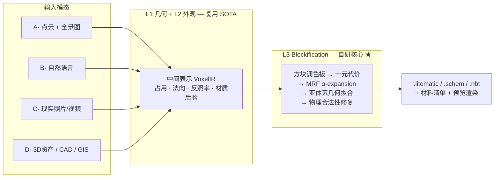

# AI 自动生成 Minecraft 体素对象

从点云、照片、自然语言或现成 3D 资产，自动生成符合 Minecraft 标准的体素模型 —— 包含**体素空间位置**、**颜色**与**材质（方块类型）**。

> 状态：**立项技术评估阶段**。本仓库当前只包含技术文档，尚无代码实现。

---

## 文档

**先读什么**：想了解项目做什么 → `00`；想判断能不能做 → `01`；想知道怎么做 → `02` `04` `05`；想知道谁在什么时候做 → `06` `07` `08`。

### 是什么 / 能不能做

| 文档 | 内容 |
|---|---|
| [00 · 产品需求文档 PRD](docs/00-PRD.md) | 目标与非目标、四层交付形态、用户角色、P0/P1/P2 功能分级、质量门禁、开源商业边界 |
| [01 · 技术可行性分析](docs/01-feasibility.md) | 问题形式化、五个本质困难、三层架构与成熟度评估、定量分析、风险登记册 |
| [03 · 参考文献索引](docs/03-references.md) | 16 个主题分类的文献与工程资源，每条标注在本项目中的具体落点 |

### 怎么做

| 文档 | 内容 |
|---|---|
| [02 · 解决方案汇总](docs/02-solutions.md) | L3 Blockification 核心算法、八类输入模态的完整管线、评测方案 |
| [04 · 技术设计总纲](docs/04-tech-design.md) | 总体架构、10 条架构决策记录（ADR）、契约定义、四种交付形态设计 |
| [05 · 公共库设计 `mcvox`](docs/05-core-library.md) | 模块划分、VoxelIR 契约、Stage 与适配器协议、关键 API、实施顺序 |

### 谁在什么时候做

| 文档 | 内容 |
|---|---|
| [06 · 项目开展计划](docs/06-roadmap.md) | 五阶段路线图、关键路径、阶段门禁、**1 人 / 2-3 人 / 4-6 人三套团队裁剪方案** |
| [07 · 分路线研发计划](docs/07-route-plans.md) | 八条输入路线各自的依赖、里程碑、验收判据、专属风险与排期建议 |
| [08 · 交付检查清单](docs/08-CHECKLIST.md) | 逐阶段可勾选的验收清单，含 16 项硬门禁汇总 |
| [09 · 工程约定](docs/09-conventions.md) | 代码、测试、数据资产、版本、许可规范 |

### 其他

| 文档 | 内容 |
|---|---|
| [评估报告网页版](docs/report.html) | 可行性评估的精编单页（含调色板色域可视化），浏览器直接打开 |

---

## 核心结论（三句话版）

1. **技术风险不在 3D 重建/生成，而在「MC 化」这一层。** VGGT、3DGS、TRELLIS.2、SAM2 已把几何与外观获取推到调库可用的成熟度；没有现成方案、必须自研、也是全部差异化价值所在的，是把 `(占用 + 反照率 + 材质语义 + 法向)` 映射到 `(方块 ID + 方块状态)` 的离散优化层。

2. **这一层有成熟理论支撑，是工程问题而非科研赌注。** 可严格形式化为带成对平滑项的 MRF-MAP 推断，用 α-expansion 求解，误差可界、可度量、可回归测试。

3. **有一个必须提前接受的物理上界：Minecraft 方块调色板的色域稀疏且有偏。** 高饱和的青、品红、纯红存在不可消除的色差。应对方式是抖动 + 色域映射 + 把「风格化再现」而非「色彩复刻」写进产品预期。

---

## 架构总览

工作量分布估计：**L1 约 15%，L2 约 30%，L3 约 55%**。

---

## 交付形态

四种形态**不是并列关系，而是分层的**——后三种全部构建在 `mcvox` 核心库之上。这个层次关系是全部架构设计的出发点，也是[公共库设计](docs/05-core-library.md)存在的理由。

| 形态 | 优先级 | 说明 |
|---|---|---|
| **D0 · `mcvox` 核心库 + CLI** | **P0** | 开源。研发期唯一必需形态，API 稳定性是后三者的前提 |
| D1 · Web 服务 | P1 | 商业托管。**⚠️ 存在版权架构冲突，须先取得法务意见** |
| D2 · 桌面应用 | P1 | 版权合规性最佳（纹理不出本机），但分发成本高 |
| D3 · Minecraft Mod | P2 | Java 侧桥接，不重写算法 |

定位：**核心开源 + 商业服务**。算法开源，人工精修的领域知识与算力服务收费。

---

## 输入模态与优先级

| 模态 | 质量 | 风险 | 阶段 |
|---|---|---|---|
| **D1 · 现成 3D 资产（OBJ/glTF + 贴图）** | ★★★★★ | 低 | **MVP 首选** |
| A · 点云（白模）+ 全景全彩图 | ★★★★☆ | 中（配准） | v1 |
| C1 · 多视角照片 / 视频 | ★★★★☆ | 中 | v1 |
| C2 · 单张照片 | ★★★☆☆ | 中 | v1 |
| B · 自然语言 | ★★★☆☆ | 中高 | v1（DSL 路线） |
| D3 · CAD / BIM (IFC) | ★★★★★ | 低 | v2 |
| D4 · GIS / DEM / OSM | ★★★★☆ | 低 | v2 |
| D5 · 手机 LiDAR / RGB-D | ★★★★☆ | 低 | v1 |

**为什么 MVP 选 3D 资产而非照片**：`(几何, 外观, 语义)` 三项全部已知，L1/L2 噪声为零，能让 L3 核心在干净条件下独立调优，并从 Objaverse 批量构造带真值的回归测试集。跳过这一步直接做照片输入，等于在噪声输入上调试未验证的核心算法。

---

## 立即可以开始的三件事

均不依赖任何模型，可并行启动：

1. **`VoxelIR` 契约定义** — 它阻塞所有人。契约定下来之前，人再多也无法并行。见[公共库设计 §3](docs/05-core-library.md)。
2. **E1 · 调色板色域量化实验** — 提取全部 `(方块, 面)` 的 Lab 平均色，计算 MC 色域在 sRGB 内的最大最近邻距离场，输出「哪些颜色表达不了」的热力图。**这个结论会直接改写产品承诺与验收标准。**
3. **打通导出链路并在真实游戏内验证放置** — 这条链路不通，其余都是空谈。不接受「文件生成成功」作为验收。

完整任务分解见[项目开展计划 §2](docs/06-roadmap.md)，逐项验收见[交付检查清单 G0](docs/08-CHECKLIST.md)。

---

## 未决问题

以下问题会阻塞对应阶段，需要决策而非技术攻关：

| # | 问题 | 阻塞 |
|---|---|---|
| Q1 | **托管服务形态下的版权方案**（服务端无法从用户自有游戏安装提取纹理） | D1 Web 服务 |
| Q3 | MC 建筑语料许可核实 | 数据驱动生成先验 |
| Q5 | 团队规模最终确定（当前按 2–3 人写计划，附 1 人与 6 人裁剪方案） | Phase 1 排期 |

全部未决问题见 [PRD §9](docs/00-PRD.md#9-风险与未决问题)。

详见 [可行性分析 §7 路线图](docs/01-feasibility.md#7-分阶段路线图)。

---

## 合规提示

Minecraft 美术资源受版权保护，**不得随本项目再分发**。合规做法：工具在用户本机从其**已购买的**游戏安装中提取纹理并生成调色板缓存；仓库内只提交**派生数值统计**（各方块面的平均 Lab 值等）并标注来源。附带好处是天然支持自定义资源包。详见 [可行性分析 R7](docs/01-feasibility.md#6-风险登记册)。
