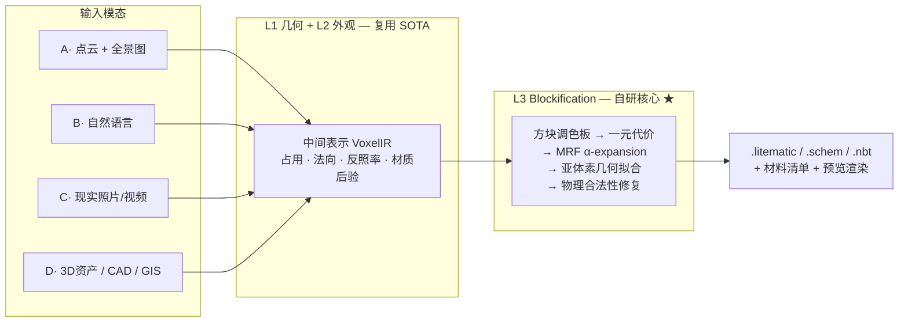

# AI 自动生成 Minecraft 体素对象

从点云、照片、自然语言或现成 3D 资产，自动生成符合 Minecraft 标准的体素模型 —— 包含**体素空间位置**、**颜色**与**材质（方块类型）**。

> 状态：**立项技术评估阶段**。本仓库当前只包含技术文档，尚无代码实现。

---

## 文档

| 文档 | 内容 |
|---|---|
| [01 · 技术可行性分析](docs/01-feasibility.md) | 问题形式化、五个本质困难、三层架构与成熟度评估、定量分析、风险登记册、分阶段路线图 |
| [02 · 解决方案汇总](docs/02-solutions.md) | 统一架构、L3 Blockification 核心算法、四类输入模态的完整管线、评测方案、技术栈 |
| [03 · 参考文献索引](docs/03-references.md) | 16 个主题分类的文献与工程资源，每条标注在本项目中的具体落点 |
| [评估报告网页版](docs/report.html) | 上述三份文档的精编单页（含调色板色域可视化），浏览器直接打开 |

---

## 核心结论（三句话版）

1. **技术风险不在 3D 重建/生成，而在「MC 化」这一层。** VGGT、3DGS、TRELLIS.2、SAM2 已把几何与外观获取推到调库可用的成熟度；没有现成方案、必须自研、也是全部差异化价值所在的，是把 `(占用 + 反照率 + 材质语义 + 法向)` 映射到 `(方块 ID + 方块状态)` 的离散优化层。

2. **这一层有成熟理论支撑，是工程问题而非科研赌注。** 可严格形式化为带成对平滑项的 MRF-MAP 推断，用 α-expansion 求解，误差可界、可度量、可回归测试。

3. **有一个必须提前接受的物理上界：Minecraft 方块调色板的色域稀疏且有偏。** 高饱和的青、品红、纯红存在不可消除的色差。应对方式是抖动 + 色域映射 + 把「风格化再现」而非「色彩复刻」写进产品预期。

---

## 架构总览

工作量分布估计：**L1 约 15%，L2 约 30%，L3 约 55%**。

---

## 输入模态与优先级

| 模态 | 质量 | 风险 | 阶段 |
|---|---|---|---|
| **D1 · 现成 3D 资产（OBJ/glTF + 贴图）** | ★★★★★ | 低 | **MVP 首选** |
| A · 点云（白模）+ 全景全彩图 | ★★★★☆ | 中（配准） | v1 |
| C1 · 多视角照片 / 视频 | ★★★★☆ | 中 | v1 |
| C2 · 单张照片 | ★★★☆☆ | 中 | v1 |
| B · 自然语言 | ★★★☆☆ | 中高 | v1（DSL 路线） |
| D3 · CAD / BIM (IFC) | ★★★★★ | 低 | v2 |
| D4 · GIS / DEM / OSM | ★★★★☆ | 低 | v2 |
| D5 · 手机 LiDAR / RGB-D | ★★★★☆ | 低 | v1 |

**为什么 MVP 选 3D 资产而非照片**：`(几何, 外观, 语义)` 三项全部已知，L1/L2 噪声为零，能让 L3 核心在干净条件下独立调优，并从 Objaverse 批量构造带真值的回归测试集。跳过这一步直接做照片输入，等于在噪声输入上调试未验证的核心算法。

---

## 立即可以开始的三件事

均不依赖任何模型，可并行启动：

1. **E1 · 调色板色域量化实验** — 提取全部 `(方块, 面)` 的 Lab 平均色，计算 MC 色域在 sRGB 内的最大最近邻距离场，输出「哪些颜色表达不了」的热力图。**这个结论会直接改写产品承诺与验收标准。**
2. **打通导出链路** — 手工构造体素数组 → `.litematic` → 在真实游戏中成功放置。这条链路不通，其余都是空谈。
3. **搭建渲染验证回路** — 自动把输出渲染成图并与参考视图比对。没有它就无法迭代。

详见 [可行性分析 §7 路线图](docs/01-feasibility.md#7-分阶段路线图)。

---

## 合规提示

Minecraft 美术资源受版权保护，**不得随本项目再分发**。合规做法：工具在用户本机从其**已购买的**游戏安装中提取纹理并生成调色板缓存；仓库内只提交**派生数值统计**（各方块面的平均 Lab 值等）并标注来源。附带好处是天然支持自定义资源包。详见 [可行性分析 R7](docs/01-feasibility.md#6-风险登记册)。
