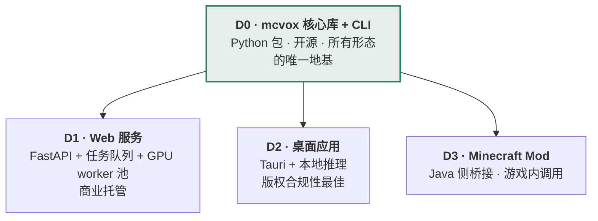

# 产品需求文档（PRD）

> AI 自动生成 Minecraft 体素对象
> 版本 v0.1 · 2026-08 · 状态：立项
> 前置阅读：[可行性分析](01-feasibility.md) · [解决方案汇总](02-solutions.md)

---

## 1. 一句话定义

**把任意来源的三维内容——点云、照片、语言描述、现成 3D 资产、CAD、地理数据——转换为可直接放进 Minecraft 的体素模型，包含空间位置、颜色与方块类型。**

区别于市面已有的"网格转方块"工具（ObjToSchematic、Bloxelizer 等）的三点：

| 已有工具 | 本项目 |
|---|---|
| 只接受 3D 网格文件 | 接受点云、照片、语言、CAD、GIS 等多模态输入 |
| 只按平均色匹配方块 | 联合优化颜色 + 材质语义 + 纹理频率 + 亚体素几何 |
| 输出全立方体方块 | 用楼梯/台阶/地毯/雪层做亚体素几何拟合，并保证物理可建造 |

---

## 2. 目标与非目标

### 2.1 目标

| # | 目标 | 可验证判据 |
|---|---|---|
| G1 | 输出严格符合 MC 标准 | 生成的 `.litematic` / `.schem` / `.nbt` 能在原版客户端正确加载并放置，无非法方块状态 |
| G2 | 输出物理可建造 | 无非法悬空、重力方块有支撑、需附着方块的附着面存在；输出材料清单 |
| G3 | 材质语义正确 | 砖看起来是砖、木看起来是木，而非仅颜色接近的任意方块 |
| G4 | 多模态输入统一后端 | 所有输入模态收敛到同一中间表示，共用同一套 MC 化核心 |
| G5 | 结果可复现 | 相同输入 + 相同参数 + 相同版本 → 逐方块相同的输出 |
| G6 | 核心可被他人复用 | 公共库有稳定 API 与文档，第三方能在其上构建自己的输入路线 |

### 2.2 非目标（明确不做）

| 非目标 | 理由 |
|---|---|
| **色彩精确复刻** | 方块调色板色域存在物理上界（可行性 §2.1）。产品定位是**风格化再现**，这一点必须写进所有对外文案 |
| **动态 / 4D 体素对象** | MC 无原生动画体素支持，需命令方块 hack，投入产出比差 |
| **红石电路 / 功能性机械的自动生成** | 是完全不同的问题域（逻辑综合而非几何映射） |
| **完整世界 / 地形生成（v1）** | GIS 模态在 v2 才做；v1 聚焦"对象" |
| **游戏内实时生成（v1）** | 生成耗时以秒到分钟计，不适合实时交互；Mod 形态是 v2+ |
| **替代人类建筑师** | 目标是给出高质量起点，而非终稿。**可编辑性优先于一次成型** |
| **基岩版为一等公民（v1）** | Java 版工具生态成熟得多；基岩版做导出兼容即可 |

> **关于「可编辑性优先于一次成型」**：这条决定了很多下游设计——输出必须是玩家能在 Litematica 里逐层建造并随时改动的结构，而不是一个黑盒结果。语言模态因此走 DSL 路线（程序可读可改），而非直接生成体素。

---

## 3. 交付形态

四种形态**不是并列关系，而是分层的**——后三种全部构建在第一种之上。这个层次关系是全部架构设计的出发点。

| 形态 | 优先级 | 阶段 | 关键约束 |
|---|---|---|---|
| **D0 · 核心库 + CLI** | **P0** | Phase 0–2 | 研发期唯一必需形态。API 稳定性是后三者的前提 |
| **D1 · Web 服务** | P1 | Phase 3–4 | **⚠️ 存在版权架构冲突，见 §7.2** |
| **D2 · 桌面应用** | P1 | Phase 4 | 版权合规性最佳（纹理不出本机），但分发与依赖管理成本高 |
| **D3 · MC Mod** | P2 | Phase 5+ | 需 Java 侧桥接；生成耗时决定它只能是异步交互 |

**结论：D0 必须按"会被三种上层形态复用"的标准来设计**，而不是按"够 CLI 用就行"。这是[公共库设计](05-core-library.md)存在的理由。

---

## 4. 用户角色与场景

| 角色 | 核心诉求 | 主要形态 | 优先级 |
|---|---|---|---|
| **MC 建筑玩家** | 把想象中的建筑快速搭出骨架，再手工精修 | D1 Web / D2 桌面 | **P0** |
| **地图作者 / 服务器主** | 批量生成场景资产，填充大型地图 | D0 CLI / D1 Web | **P0** |
| **内容创作者（视频/直播）** | "把现实物体搬进 MC"的选题，需要有传播性的效果 | D1 Web | P1 |
| **开发者 / 研究者** | 在 mcvox 上构建自己的输入路线或算法实验 | D0 库 | **P0** |
| **建筑 / 房产可视化** | 把 BIM 模型转成 MC 供客户直观浏览 | D0 CLI / D1 Web | P2 |
| **教育工作者** | 把地形、分子、历史建筑变成可探索的 MC 场景 | D1 Web | P2 |

> **P0 角色里有「开发者」是一个有意的选择**：核心开源模式下，第三方在 mcvox 上构建路线是生态扩张的主要方式，也是验证公共库 API 设计是否合格的唯一真实检验。

### 关键场景

- **S1 · 已有模型搬家**：设计师有一个 glTF 模型，想放进 MC 服务器当地标（→ 模态 D1，MVP）
- **S2 · 现实建筑复刻**：玩家绕自家房子拍 40 张照片，生成 MC 版本（→ 模态 C1）
- **S3 · 扫描场景还原**：用 Matterport 扫描的室内点云 + 全景图还原整个房间（→ 模态 A）
- **S4 · 文字造物**：输入"一座带塔楼的中世纪石砌教堂"直接得到结构（→ 模态 B）
- **S5 · 批量填充**：地图作者需要 50 棵形态各异的树（→ D0 CLI 批处理）

---

## 5. 功能需求

### P0 — MVP 必须有

| ID | 功能 | 验收判据 |
|---|---|---|
| F-01 | 方块调色板构建（从资源提取 `(方块,面) → Lab`） | 覆盖 Java 1.21 全部可用作颜色源的方块；输出版本化缓存 |
| F-02 | **E1 色域分析报告** | 产出最近邻距离场热力图与分色相 ΔE₀₀ 统计 |
| F-03 | 网格实体体素化（广义缠绕数） | 对非水密/自相交网格不产生空洞；Voxel IoU ≥ 0.95（对水密真值） |
| F-04 | 一元项颜色匹配 + 3D 蓝噪声抖动 | 抖动无方向性伪影（旋转 360° 观察验证） |
| F-05 | 材质映射表 v1（≥20 类） | 每类 ≥5 个候选方块；支持 YAML 定义 |
| F-06 | 导出 `.litematic` / `.schem` / `.nbt` | **在真实客户端加载放置成功**（不接受"文件生成成功"作为验收） |
| F-07 | 材料清单输出 | CSV，含方块 ID、数量、获取难度 tier |
| F-08 | `voxels_per_meter` 显式尺度控制 | 用户可指定目标尺寸或体素密度 |
| F-09 | CLI：`mcvox convert` 单命令走通 | 输入文件 → 输出 schematic |
| F-10 | 回归测试框架 | Objaverse 200 对象自动跑分，指标入库可对比 |

### P1 — v1 目标

| ID | 功能 | 验收判据 |
|---|---|---|
| F-11 | MRF 成对项 + α-expansion 求解 | 相比纯一元项，方块碎片化显著下降（连通块平均尺寸提升） |
| F-12 | 方块共现先验（从建筑语料统计） | 从 ≥1000 个真实建筑统计得出 |
| F-13 | **亚体素几何拟合**（楼梯/台阶/地毯/雪层） | 屋顶、球面的 Hausdorff 误差相比纯全方块下降 ≥30% |
| F-14 | 物理合法性修复 pass 链 | 物理合法率 100%（硬性门禁） |
| F-15 | 去光照（RGB↔X 集成） | 同色墙面在明暗区不被切成不同方块 |
| F-16 | 材质语义分割（SAM2 + 开放词表） | DMS 基准上 mIoU 达标（阈值待 Phase 2 定） |
| F-17 | 多风格映射表（中世纪/现代/工业/东亚） | ≥4 套；用户可切换并看到明显差异 |
| F-18 | 模态 D1 资产输入路线 | 完整可用 |
| F-19 | 模态 C1/C2 照片输入路线 | 完整可用 |
| F-20 | 模态 A 点云+全景路线 | 同源采集设备可用 |
| F-21 | 模态 B 语言 DSL 路线 + Verifier | 简单建筑描述 3 轮内收敛 |
| F-22 | 渲染预览（多角度 PNG） | 生成结果附预览图 |
| F-23 | 材料预算约束（生存模式可建） | 用户可设预算上限，超出时自动降级替换 |

### P2 — v2 及以后

| ID | 功能 |
|---|---|
| F-24 | Web 服务（D1 形态） |
| F-25 | 桌面应用（D2 形态） |
| F-26 | 稀疏体素离散扩散先验（替换手工共现项） |
| F-27 | 模态 D3 CAD/BIM 输入 |
| F-28 | 模态 D4 GIS/DEM/OSM 输入 |
| F-29 | 低分辨率体素超分（D6） |
| F-30 | 交互式局部重生成 |
| F-31 | 逐块建造顺序动画（借 3D-Craft 的人类建造顺序） |
| F-32 | MC Mod（D3 形态） |
| F-33 | 基岩版 `.mcstructure` 导出 |

---

## 6. 质量需求

### 6.1 性能预算

| 场景 | 目标 | 备注 |
|---|---|---|
| N=128 资产转换（L3 全流程） | < 30 s | CPU 16 核 |
| N=256 资产转换 | < 3 min | 含 MRF 求解 |
| 照片路线（40 张，含重建） | < 15 min | 单卡 24 GB |
| 单图路线（TRELLIS 捷径） | < 90 s | 单卡 24 GB |
| 调色板构建（一次性） | < 60 s | 结果缓存复用 |
| 峰值显存 | ≤ 22 GB | 保证 24 GB 消费卡可跑 |

### 6.2 质量门禁（不达标不发布）

| 指标 | 阈值 |
|---|---|
| 物理合法率 | **100%**（硬性） |
| 导出文件客户端加载成功率 | **100%**（硬性） |
| 可复现性（相同输入输出逐方块一致） | **100%**（硬性） |
| Voxel IoU（对水密真值） | ≥ 0.90 |
| 逐面 ΔE₀₀ p95 | ≤ 15（**在 E1 确定的可达色域内**） |
| 回归测试集通过率 | ≥ 95% |

> ΔE₀₀ 的阈值必须**限定在 E1 实测的可达色域内**才有意义。对色域外的高饱和输入，指标应单独统计并在报告中标注，不能混入总体均值掩盖问题。

### 6.3 可复现性

生成结果必须附带 `provenance`：输入哈希、mcvox 版本、模型版本、调色板版本、全部参数、随机种子。**任何随机性必须由显式种子驱动。** 这既是质量要求，也是商业服务的售后依据。

---

## 7. 商业与许可

### 7.1 开源 / 商业边界

| 组件 | 许可 | 理由 |
|---|---|---|
| `mcvox` 核心库（L1/L2/L3 全部算法） | **开源**（建议 Apache-2.0） | 生态与可信度的来源；也是吸引第三方贡献输入路线的前提 |
| CLI | 开源 | 同上 |
| 基础材质映射表（vanilla + 1 套风格） | 开源 | 让开源用户能得到可用结果 |
| 回归测试框架 | 开源 | 可复现性是学术与工程可信度的基础 |
| **精修风格映射表包**（≥4 套精修风格） | 商业 | 人工精修成本高，是真实差异化价值 |
| **托管 Web 服务** | 商业 | GPU 成本 + 便利性 |
| **训练好的材质分类/生成模型权重** | 待定 | 视训练数据许可而定，可能需开源 |

> 边界原则：**算法开源，人工精修的领域知识与算力服务收费。** 这条边界清晰、可辩护，也不会因为"藏了核心算法"而损害社区信任。

### 7.2 ⚠️ 版权架构冲突（必须在 D1 形态设计前解决）

可行性分析 R7 的缓解措施是「纹理只在用户本机从其自有游戏安装提取」。**这条在 D0 CLI 和 D2 桌面形态下成立，但在 D1 托管服务形态下不成立**——服务端没有、也不该有用户的游戏安装。

三个可选解法，需在 Phase 3 前决策：

| 方案 | 做法 | 代价 |
|---|---|---|
| **A · 只存派生数值**（倾向选择） | 服务端只保存 `(方块,面) → Lab 均值/方差/频率` 等**统计数值**，不存任何纹理像素。预览渲染用纯色块而非真实纹理 | 预览保真度下降；仍需法务确认"派生统计数值"的性质 |
| **B · 客户端提取上传** | 用户在本地跑一个小工具生成调色板缓存并上传 | 使用门槛显著提高，与"托管服务图方便"的初衷矛盾 |
| **C · 完全自制纹理集** | 自建一套开源纹理，只做几何与语义，不碰官方美术 | 结果与真实 MC 观感脱节，失去核心价值 |

**当前倾向 A，但必须在 Phase 3 启动前取得法务意见。** 这是一个会阻塞 D1 形态的前置条件，不是可以边做边想的问题。

### 7.3 数据许可

训练/统计语料（3D-Craft、Planet Minecraft、GrabCraft 抓取的 schematic）**必须逐个核实许可与 ToS**，并在仓库中留下溯源记录。任何许可不明的数据不得进入发布的模型权重或统计表。

---

## 8. 成功指标

分三条线，避免单一维度误导。

### 技术线（Phase 1–2 主看）

- 回归测试集指标持续改善且无回退
- 物理合法率、加载成功率、可复现性三项硬指标保持 100%
- 亚体素拟合带来的 Hausdorff 误差下降幅度

### 社区线（开源，Phase 3 起主看）

- 第三方在 mcvox 上实现的输入路线数量 —— **这是公共库 API 设计是否合格的唯一真实检验**
- 贡献者数量与外部提交的材质映射表数量
- 在 MC 建筑社区（Planet Minecraft、r/Minecraft、B 站/YouTube 建筑区）出现的自发使用案例

### 商业线（D1 上线后）

- 生成任务完成率与用户重试率（重试率高 = 结果不满意的代理指标）
- 单次生成 GPU 成本 vs 定价
- 从免费额度到付费的转化率
- 精修风格包的附加购买率

---

## 9. 风险与未决问题

技术风险见[可行性分析 §6 风险登记册](01-feasibility.md#6-风险登记册)。此处只列**产品与商业层面**的未决问题：

| # | 问题 | 需在何时解决 | 负责 |
|---|---|---|---|
| Q1 | **D1 形态的版权方案**（§7.2）法务意见 | Phase 3 启动前，**阻塞项** | 待定 |
| Q2 | E1 实测色域结果是否会迫使调整产品承诺 | Phase 0 结束 | 待定 |
| Q3 | 语料许可核实结果是否允许训练可发布的模型 | Phase 4 启动前 | 待定 |
| Q4 | `mcvox` 包名在 PyPI 是否可用 | Phase 0 | 待定 |
| Q5 | 团队规模最终确定（当前按 2–3 人写计划，附裁剪方案） | Phase 1 启动前 | 待定 |
| Q6 | 商业定价模型（按次 / 订阅 / 额度） | D1 上线前 | 待定 |
| Q7 | 是否接受 Mojang 可能的态度变化风险 | 持续关注 | 待定 |

---

## 10. 下游文档

| 文档 | 内容 |
|---|---|
| [04 · 技术设计总纲](04-tech-design.md) | 架构、关键技术决策、契约、非功能设计 |
| [05 · 公共库设计](05-core-library.md) | mcvox 模块划分、API 契约、IR schema、扩展机制 |
| [06 · 项目开展计划](06-roadmap.md) | 总体路线图、里程碑门禁、团队规模裁剪方案 |
| [07 · 分路线研发计划](07-route-plans.md) | 8 条输入路线各自的依赖、里程碑、验收、风险 |
| [08 · 交付检查清单](08-CHECKLIST.md) | 逐阶段可勾选的验收清单 |
| [09 · 工程约定](09-conventions.md) | 代码、测试、文档、版本、许可规范 |
