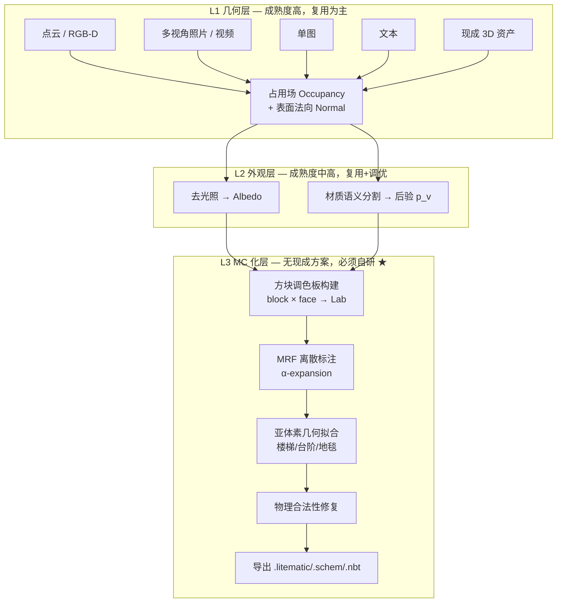

# 技术可行性分析

> AI 自动生成 Minecraft 体素对象项目 · 立项技术评估
> 版本 v0.1 · 2026-08

---

## 0. 结论摘要

**总体判断：整体可行，但"可行性"在不同输入模态上差异极大，必须分阶段推进。**

核心结论有四条：

1. **本项目的技术风险不在 3D 重建/生成，而在"MC 化"这一层。** 从点云、照片、文本得到几何与外观，2023–2026 年的成果（VGGT、3DGS、TRELLIS.2、SAM2、RGB↔X）已经把这部分推到了"调库即可用"的成熟度。真正没有现成方案、必须自研、也是项目全部差异化价值所在的，是把 **(占用 + 反照率 + 材质语义 + 法向)** 联合映射到 **(方块 ID + 方块状态)** 的离散优化层。本文将其称为 **L3 / Blockification**。

2. **L3 有成熟的理论支撑，不是开放性研究难题。** 它可以严格形式化为一个带成对平滑项的离散标注问题（MRF-MAP 推断），用 α-expansion / graph-cut 求近似最优解，误差可界、可度量。这意味着它是**工程问题而非科研赌注**。若要更高上限，可在 MC 建筑语料上训练稀疏体素离散扩散模型替换手工先验——但这是 v2 的事，不是 MVP 的前提。

3. **有一个硬性的物理上界必须提前接受：Minecraft 方块调色板的色域是稀疏且有偏的。** 大量灰/棕/绿，缺高饱和的青、品红、纯红。任何输入的高饱和区域都会产生不可消除的色差。应对方式是抖动 + 色域映射（gamut mapping）+ 把"风格化"写进产品预期，而不是承诺色彩保真。**建议在第 1 周就做完调色板色域量化实验**，因为它的结论会直接改写产品文案与验收标准。

4. **模态优先级应当与直觉相反。** 最该先做的不是"照片→MC"（最有传播性），而是"**现成 3D 资产（OBJ/glTF + 贴图）→ MC**"。因为它的 L1/L2 输入是已知真值，能让团队把全部精力压在 L3 上，并建立自动回归测试集。等 L3 稳定后，其他模态只是在前面接不同的 L1/L2 管线。

---

## 1. 问题形式化

### 1.1 输出定义

一个 Minecraft 体素对象是一个稀疏离散场：

```
M = { (p, b, s) | p ∈ Z³, b ∈ B, s ∈ S(b) }
```

- `p` — 整数体素坐标（局部坐标系，导出时平移到世界坐标）
- `b` — 方块类型，取自方块库 `B`（Java 版 1.21 约 1000 种方块）
- `s` — 方块状态（blockstate），如楼梯的 `facing`/`half`/`shape`、台阶的 `type`、原木的 `axis`。`S(b)` 是该方块的合法状态集

关键性质，也是全部难度的来源：

| 性质 | 含义 | 后果 |
|---|---|---|
| **离散性** | 颜色不是自由 RGB，只能从固定方块集中选 | 这是量化问题，不是回归问题 |
| **各向异性** | 一个方块六个面纹理可不同（草方块顶绿侧土） | 颜色匹配依赖观察面法向 |
| **亚体素几何** | 楼梯/台阶/地毯/雪层提供 1/2、1/8、1/16 体素精度 | 可显著降低阶梯走样，但扩大搜索空间 |
| **物理约束** | 沙/砾/混凝土粉末受重力；火把/门/床需支撑 | 输出必须做合法性修复，否则一放置就塌 |
| **纹理非纯色** | 每个面是 16×16 纹理，有频率与方差 | 只用平均色匹配会把平滑面配到高频纹理块 |

### 1.2 输入定义

统一抽象为：`I → (G, A, Σ)`

- `G` 几何：占用场 / 点云 / 网格 / SDF
- `A` 外观：表面反照率（去光照后的固有色）
- `Σ` 语义：每处表面的材质类别后验分布

不同输入模态的差别，**仅在于 `(G, A, Σ)` 从哪里来、以及哪一项缺失**。这是本项目架构分层的依据。

### 1.3 目标函数

求 `b: V → B × S`，最小化

```
E(b) = Σ_v [ λ_c·D_color(a_v, c(b_v, n_v))          # 颜色项
           + λ_m·(−log p_v(mat(b_v)))                # 材质语义项
           + λ_g·D_geom(r_v, geom(b_v)) ]            # 亚体素几何项
     + Σ_(u,v)∈N λ_s·ψ(b_u, b_v)                     # 平滑/共现先验（pairwise）
     + λ_p·Φ_physics(b)                              # 物理合法性
     + λ_b·Ψ_budget(b)                               # 材料预算（可建性）
```

- 前三项是**一元项**，全部可预计算成查找表 → O(|V|·|B|) 且高度并行
- `ψ` 是**成对项**，使问题成为 MRF。若 `ψ` 满足度量性质，α-expansion 有 2 倍近似比保证
- `Φ_physics`、`Ψ_budget` 建议作为**后处理修复 pass** 而非能量项，工程上简单得多且效果等价

**这一形式化的意义**：它把一个模糊的"AI 生成"需求，转化成一个有五十年文献支撑的、可求解、可度量、可回归测试的组合优化问题。这是本项目最重要的可行性依据。

---

## 2. 五个本质困难

### 2.1 调色板色域缺口（不可消除，只能缓解）

MC 可用作"颜色源"的全立方体不透明方块，粗估在 250–400 个之间（16 色羊毛/混凝土/陶瓦/带釉陶瓦 + 各木材/石材系列 + 自然方块）。**精确数字必须实测统计，不能拍脑袋。**

这些颜色在 CIELAB 中的分布高度不均：中低明度的灰/棕/绿密集，高饱和青、品红、纯红稀疏。

- 预期：低饱和区最近邻色差 ΔE₀₀ < 5（几乎不可察觉）
- 预期：高饱和区最近邻色差 ΔE₀₀ > 20（明显失真）

> **[实验 E1 · 第 1 周]** 从游戏资源提取全部方块 (block, face) 的 Lab 平均色与方差，计算调色板在 sRGB 色域内的**最大最近邻距离场**，输出一张"哪些颜色 MC 表达不了"的热力图。此实验的产出直接决定产品能承诺什么。

**缓解手段**：3D 蓝噪声抖动扩展感知色域；输入侧做 gamut mapping（把输入色域压缩进 MC 色域，保序不保绝对值）；把结果定位为"风格化再现"而非"色彩复刻"。

### 2.2 尺度歧义（Scale Ambiguity）

单图重建与纯 SfM 都**没有绝对尺度**。而"一个方块 = 多少米"决定了体素分辨率，进而决定一切。

- 若强行令 1 block = 1 m：10 米高的房子只有 10 层体素，门窗细节全部丢失
- 几何量化误差上界为 √3/2·s（s 为体素边长），要让人形保留可辨识度，经验上需 ≥16–24 体素高

**结论：必须把 `voxels_per_meter` 作为显式的一等参数暴露给用户，并提供三种定标途径**——用户直接给尺寸、场景中已知物体（门/人）反推、或使用 metric depth 模型（Depth Anything V2 metric 分支 / Metric3D v2）/ LiDAR 直接给真值。这不是可选项。

### 2.3 光照烘焙污染（最容易被低估）

若直接用照片像素颜色去匹配方块，阴影会被烤进方块选择——同一面白墙会被切成明暗两种方块，形成难看的色块分界。

必须在 L2 插入**去光照 / 内在图像分解**步骤，取 albedo 而非 RGB。RGB↔X（SIGGRAPH 2024）与 Colorful Diffuse Intrinsic Image Decomposition（TOG 2024）是当前可直接用的方案。

> 这一步的投入产出比在整条管线里最高。**它是"看起来像 AI 玩具"和"看起来像人类建筑师作品"的分界线。**

### 2.4 语义-方块映射的知识缺口

"这是砖" → 该用 `bricks` 还是 `red_nether_bricks` 还是 `granite`？这是一张需要**人工精修的领域知识表**（约 30 个材质大类 × 每类 5–30 个候选方块），没有模型能凭空替代。

它是项目的**核心数据资产**，也是最容易被工程排期忽略的一项。建议独立立项、版本化管理、支持按风格（中世纪/现代/工业/东亚）切换多套映射表。

### 2.5 大语言模型在长程 3D 坐标上的一致性差

直接让 LLM 输出体素坐标列表，在超过几百个方块后会出现对称性破缺、坐标漂移、结构不闭合。T2BM（[arXiv:2406.08751](https://arxiv.org/abs/2406.08751)）引入"层间表示 + 修复"正是在打这个补丁。

**结论：语言模态不应走"LLM 直吐体素"路线，应走"LLM 输出建造 DSL / 程序"路线**（详见方案文档 §5）。程序天然保证对称、重复、参数化，且可读、可编辑、可重跑。

---

## 3. 三层架构与成熟度评估



### 逐模块技术成熟度（TRL）

| 层 | 模块 | 现成方案 | TRL | 自研工作量 |
|---|---|---|---|---|
| L1 | 多视角位姿+点云 | VGGT / DUSt3R / COLMAP | 9 | 极低（集成） |
| L1 | 高保真外观场 | 3DGS / 2DGS / SuGaR | 9 | 低 |
| L1 | 单图/文本→3D | TRELLIS.2 / Hunyuan3D / Ultra3D | 8 | 低 |
| L1 | 网格→体素化 | libigl 广义缠绕数 / OpenVDB | 9 | 低 |
| L1 | 全景深度 | Depth Any Panoramas / 360MonoDepth | 7 | 中（畸变处理） |
| L2 | 实例/区域分割 | SAM2 / Grounded-SAM | 9 | 极低 |
| L2 | 材质分类 | DMS / MatSeg / CLIP 开放词表 | 6 | **中高（需微调）** |
| L2 | 去光照 | RGB↔X / Colorful Diffuse IID | 7 | 中 |
| L2 | 3D 语义一致性融合 | Gaussian Grouping / OpenSplat3D | 7 | 中 |
| **L3** | **方块调色板提取** | 无（工具零散） | — | **中，必须自研** |
| **L3** | **MRF 联合标注** | 理论成熟，无 MC 实现 | — | **高，核心** |
| **L3** | **亚体素几何拟合** | 无 | — | **高，差异化点** |
| **L3** | **物理合法性修复** | 无 | — | 中 |
| L3 | 格式导出 | Amulet-Core / mcschematic | 9 | 低 |

**工作量分布结论：L1 约 15%，L2 约 30%，L3 约 55%。** 项目排期与人力应据此配置。任何把主要精力放在"选哪个 3D 生成模型"上的规划都是错配的。

---

## 4. 关键定量分析

### 4.1 规模与内存（结论：不构成瓶颈）

分辨率 N³ 的对象，表面体素数约 6N²：

| N | 表面体素数 | 稀疏存储（14 B/voxel） | 可行性 |
|---|---|---|---|
| 64 | ~25 K | 0.3 MB | 轻松 |
| 128 | ~98 K | 1.4 MB | 轻松 |
| 256 | ~390 K | 5.5 MB | 舒适 |
| 512 | ~1.5 M | 21 MB | 接近实用上限（放置需分块） |
| 1024 | ~6 M | 84 MB | 需分块流式，客户端渲染吃力 |

**内存与算力不是瓶颈。** 瓶颈是 MC 客户端的放置/渲染性能与格式限制：

- 原版结构方块（Structure Block）：**48×48×48 硬上限**
- Sponge Schematic `.schem` / Litematica `.litematic`：无硬上限，受内存约束
- WorldEdit `//paste`：受服务器 `//limit` 与区块加载限制，大结构需分块粘贴

> 建议默认目标分辨率 **N ≈ 128–256**，并对 >48 的输出默认导出 `.litematic`，同时提供切分为 48³ 结构方块块的选项。

### 4.2 分辨率-保真度关系

几何 Hausdorff 误差上界 √3/2·s ≈ 0.87s。经验阈值：

| 对象 | 最小可辨识体素高度 | 说明 |
|---|---|---|
| 简单几何体 | 8–16 | 立方/柱/球 |
| 建筑（含门窗） | 24–48 | 门窗需 ≥3×2 体素 |
| 人形/生物 | 16–32 | 面部特征需 ≥32 |
| 机械/装置细节 | 48+ | 常需亚体素原语补足 |

亚体素原语（楼梯 1/2、台阶 1/2、雪层 1/8、地毯 1/16）可在**不提高体素分辨率的前提下**把有效几何精度提升约一档。这是 MC 特有的杠杆，也是本项目最值得投入的差异化技术点。

### 4.3 误差预算（端到端）

| 环节 | 典型误差 | 可控性 |
|---|---|---|
| 重建几何误差 | 1–5 mm（LiDAR）/ 1–3%（SfM 相对） | 高 |
| 尺度标定误差 | 0%（给定尺寸）/ 5–20%（单图估计） | **中，需用户介入** |
| 体素量化误差 | ≤0.87s | 由分辨率决定 |
| 去光照残差 | ΔE₀₀ 3–10 | 中 |
| 调色板量化 | ΔE₀₀ 2–25（强烈依赖色相） | **低，物理上界** |
| 材质分类错误 | 5–25% 类别错误率 | 中，靠映射表兜底 |

**主导误差项是调色板量化与材质分类。** 这再次印证：优化重点在 L3 与 L2，不在 L1。

---

## 5. 逐输入模态可行性评级

评级说明：**质量** = 预期输出观感；**工作量** = 相对人月；**风险** = 技术不确定性。

| # | 输入模态 | 质量 | 工作量 | 风险 | 建议阶段 |
|---|---|---|---|---|---|
| D1 | **现成 3D 资产（OBJ/glTF+贴图）** | ★★★★★ | 低 | 低 | **MVP 首选** |
| A | 点云（白模）+ 全景全彩图 | ★★★★☆ | 中 | **中（配准）** | v1 |
| C1 | 多视角照片 / 视频 | ★★★★☆ | 中高 | 中 | v1 |
| C2 | 单张照片 | ★★★☆☆ | 低 | 中（尺度、背面幻觉） | v1（借 TRELLIS.2） |
| B | 自然语言文本 | ★★★☆☆ | 中高 | **中高（一致性）** | v1（DSL 路线） |
| D3 | CAD / BIM (IFC) | ★★★★★ | 中 | 低 | v2（垂直场景高价值） |
| D4 | GIS / DEM / OSM | ★★★★☆ | 中 | 低 | v2（世界尺度） |
| D5 | 手机 LiDAR / RGB-D 扫描 | ★★★★☆ | 低 | 低 | v1（是模态 A 的最佳采集手段） |
| D2 | 手绘三视图 / 概念图 | ★★☆☆☆ | 中 | 高 | v2 |
| D6 | 低分辨率体素 → 超分 | ★★★☆☆ | 中 | 中 | v2 |
| D7 | 视频 → 动态 4D | ★☆☆☆☆ | 高 | 很高 | **暂不列入范围** |

### 为什么 D1（现成 3D 资产）应当是 MVP

1. `(G, A, Σ)` 三项全部已知或近似已知 —— 几何精确、贴图即 albedo（近似）、材质名常在 MTL/glTF material 里
2. 可从 Objaverse 批量取样，构造**带真值的自动回归测试集**
3. 能让 L3 在没有 L1/L2 噪声干扰的条件下独立调优 —— 这是把核心模块做扎实的唯一方法
4. 本身就有真实用户需求（把已有 3D 模型搬进 MC）

**跳过 D1 直接做照片输入，等于在噪声输入上调试未验证的核心算法，会显著拉长收敛时间。**

---

## 6. 风险登记册

| ID | 风险 | 影响 | 概率 | 缓解措施 |
|---|---|---|---|---|
| R1 | 调色板色域不足，高饱和物体效果差 | 高 | **确定发生** | 第 1 周做 E1 实验量化；抖动 + 色域映射；产品文案定位为风格化 |
| R2 | 材质语义分类精度不足 | 高 | 中 | 映射表兜底；允许用户手动改写材质；在 DMS/MatSeg 上微调 |
| R3 | 点云与全景图配准失败（异源采集） | 中 | 中 | 优先支持同源采集设备；提供渲染-匹配的自动配准 + 手动标点兜底 |
| R4 | 尺度估计错误导致分辨率荒谬 | 中 | 中 | `voxels_per_meter` 显式化 + 三种定标途径 + 生成前预览 |
| R5 | LLM 生成结构不闭合/不对称 | 中 | 高 | 走 DSL 路线；加 verifier 闭环自修复 |
| R6 | MRF 求解在大规模体素上过慢 | 中 | 中 | 分块求解 + 只在表面体素上优化 + 一元项 GPU 预计算 |
| R7 | **游戏资源版权** — 提取并再分发方块纹理 | 中 | 中 | **不再分发纹理**；只分发派生的 Lab 统计数值；纹理在用户本机从其自有 `.jar` 提取；支持资源包 |
| R8 | 输出结构在生存模式不可建造 | 低 | 中 | 材料预算项 + 物理修复 pass + 输出材料清单 |
| R9 | MC 版本更新导致方块表失效 | 低 | 高 | 方块表按版本号版本化；建立版本迁移映射 |

> R7 值得单独说明：Minecraft 的美术资源受版权保护，不能随项目再分发。合规做法是——工具在用户本地从其**已购买的**游戏安装中提取纹理生成调色板缓存；仓库内只提交**派生的数值统计**（各方块面的平均 Lab 值等），并明确标注来源。这同时带来一个好处：天然支持自定义资源包。

---

## 7. 分阶段路线图

### Phase 0 — 地基（2–3 周）

- **E1 调色板色域量化实验**（第 1 周，最高优先级）
- 从游戏资源程序化提取 `(block, face) → (Lab 均值, 方差, 频率特征)` 查找表
- 打通导出链路：稀疏体素 → `.litematic` / `.schem` / `.nbt`，并在真实游戏中验证放置
- 搭建渲染验证回路（Chunky / Mineways 渲染 vs 参考视图）

**Phase 0 的验收标准**：能手工构造一个体素数组，导出后在 MC 里正确放置并渲染出来。这条链路不通，后面全部无意义。

### Phase 1 — MVP：3D 资产 → MC（4–6 周）

- 网格体素化（广义缠绕数实体体素化）
- 一元项颜色匹配 + 3D 蓝噪声抖动
- 基础材质映射表 v1（约 20 类）
- 自动回归测试集（Objaverse 采样 200 个对象）
- 指标基线：Voxel IoU、ΔE₀₀ 分布、渲染 LPIPS

### Phase 2 — L3 核心深化（4–6 周）

- MRF 成对项 + α-expansion 求解
- 方块共现先验（从 MC 建筑语料统计）
- 亚体素几何拟合（楼梯/台阶/地毯/雪层）
- 物理合法性修复 pass
- 材料预算约束

### Phase 3 — 多模态接入（各 3–5 周，可并行）

- 3A：照片/视频（VGGT → 3DGS → 表面 → 体素）
- 3B：点云 + 全景（配准 + 投影烘焙）
- 3C：语言（DSL + LLM + verifier 闭环）
- 3D：单图（TRELLIS.2 直接在其稀疏体素结构上做 L3 —— 见方案文档 §6.2 的捷径）

### Phase 4 — v2 研究上限（可选）

- 在 MC 建筑语料上训练稀疏体素离散扩散/自回归先验，替换手工 `ψ`
- 风格条件化（中世纪/现代/工业/东亚）
- 交互式编辑与局部重生成

---

## 8. 资源估算

| 项 | 估算 | 说明 |
|---|---|---|
| 核心研发 | 2–3 人 × 4–6 个月 至 v1 | 1 人主攻 L3，1 人主攻 L1/L2 集成，0.5–1 人工程/服务化 |
| 领域知识 | 0.5 人月 × 持续 | 材质映射表精修，最好由资深 MC 建筑玩家参与 |
| GPU（开发） | 1–2 × 24 GB（4090/A6000 级） | TRELLIS.2 / 3DGS / SAM2 推理 |
| GPU（训练，Phase 4 才需要） | 4–8 × 80 GB | 仅当走数据驱动先验路线 |
| 存储 | 1–5 TB | Objaverse 子集 + MC 语料 + 中间产物 |

**MVP 阶段不需要训练算力**，全部是推理 + 经典优化。这大幅降低了立项门槛。

---

## 9. 明确不建议的路线

为避免走弯路，以下方向经评估应当排除或推迟：

| 路线 | 不建议理由 |
|---|---|
| 端到端训练"照片 → 方块序列"单一大模型 | 无对齐数据集；不可解释；不可局部编辑；成本极高。分层管线在质量与成本上全面占优 |
| LLM 直接输出体素坐标列表 | 长程一致性差（§2.5）。DSL 路线严格占优 |
| 用 2D map-art 算法直接推广到 3D | Floyd–Steinberg 的方向性伪影在 3D 自由视角下明显；需换蓝噪声 |
| 忽略去光照直接用像素色匹配 | 阴影烤进方块选择，是"业余感"的最主要来源（§2.3） |
| 追求 1 block = 1 m 的物理正确 | 会毁掉细节。应显式暴露 `voxels_per_meter` |
| 视频 → 动态 4D MC 对象 | MC 无原生动画体素支持；需命令方块/数据包 hack，投入产出比差 |
| 再分发从游戏提取的纹理 | 版权风险（R7）。只分发派生数值 |

---

## 10. 立项建议

**建议立项，按 Phase 0 → 1 → 2 → 3 推进，并把下述三条作为不可协商的前提：**

1. **第 1 周完成 E1 调色板色域实验**，用数据而非直觉设定质量预期与产品承诺
2. **MVP 锁定"现成 3D 资产 → MC"模态**，把 L3 打扎实后再接其他输入
3. **Phase 0 必须打通真实游戏内的放置验证**，不允许仅以"文件生成成功"作为验收

技术方案细节见 [解决方案汇总](02-solutions.md)，文献与工程资源见 [参考文献索引](03-references.md)。
