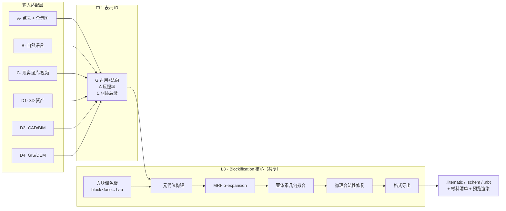
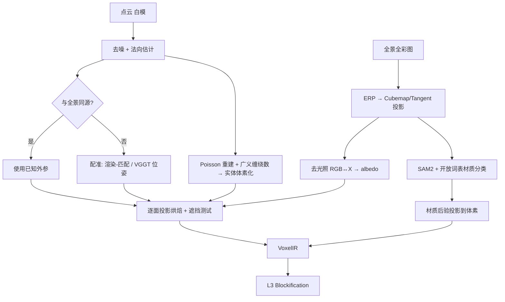
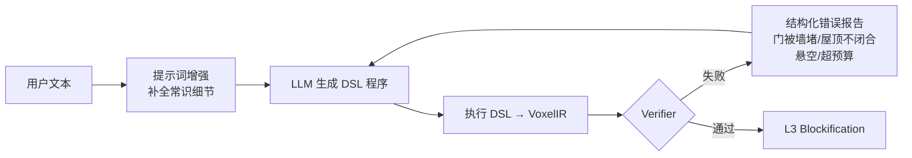

# 解决方案汇总

> AI 自动生成 Minecraft 体素对象 · 分模态技术方案
> 版本 v0.1 · 2026-08 · 配套阅读：[可行性分析](01-feasibility.md) · [参考文献索引](03-references.md)

---

## 1. 统一架构

全部输入模态共享同一个后端。差异只在于前端如何得到三元组 `(G, A, Σ)`。



**设计要点：中间表示 IR 是架构的枢纽。** 它必须先于任何模态管线定义清楚，否则每接一个新输入都会污染核心层。

### 1.1 中间表示（IR）规格

```python
@dataclass
class VoxelIR:
    # 几何
    occupancy:   sparse.COO          # (X,Y,Z) bool，稀疏
    normal:      np.ndarray          # (Nv, 3) float32，表面体素的外法向
    residual:    np.ndarray          # (Nv,) float32，真实表面到体素中心的有符号偏移
                                     #   ∈ [-0.5, 0.5]，驱动亚体素原语选择
    face_vis:    np.ndarray          # (Nv, 6) bool，六个面是否暴露（±X ±Y ±Z）

    # 外观（去光照后）
    albedo:      np.ndarray          # (Nv, 6, 3) float32，OKLab，逐面
    albedo_conf: np.ndarray          # (Nv, 6) float32，观测置信度（0 = 未被任何视角看到）
    roughness:   np.ndarray | None    # (Nv, 6) 可选，用于区分金属/哑光

    # 语义
    mat_logits:  np.ndarray          # (Nv, M) float32，M 个材质类别的 logit
    mat_taxonomy: list[str]          # 材质类别名，长度 M
    instance_id: np.ndarray | None    # (Nv,) int32，可选，物体部件分组

    # 元数据
    voxels_per_meter: float          # 尺度锚点，必填
    up_axis:     str                 # 'Y'（MC 约定）
    provenance:  dict                # 来源模态、模型版本、参数，用于复现
```

三点设计理由：

- **逐面存储外观（`(Nv, 6, 3)`）而非逐体素**。因为 MC 方块各向异性，且不同面被不同视角观测到、置信度不同。逐体素平均会丢掉草方块顶/侧的关键区分。
- **`residual` 显式保留**。体素化通常丢弃这个量，但它正是亚体素原语（楼梯/台阶）的驱动信号。丢了就再也拿不回来。
- **`albedo_conf` 记录未观测区域**。物体背面、内部、遮挡区没有观测，必须区别对待（走补全或纯语义推断），不能当成黑色。

---

## 2. L3 核心：Blockification（本项目的技术心脏）

### 2.1 方块调色板构建

**目标**：得到查找表 `c(b, face) → (Lab_mean, Lab_std, freq_energy)`。

**流程**：

1. 从用户本地 Minecraft 安装（`versions/<ver>/<ver>.jar`）或资源包中读取：
   - `assets/minecraft/models/block/*.json` — 模型定义，指明每个面用哪张纹理
   - `assets/minecraft/blockstates/*.json` — 方块状态到模型的映射
   - `assets/minecraft/textures/block/*.png` — 纹理本体
2. 解析模型继承链（`parent` 字段），解析出每个 `(block, blockstate, face)` 实际使用的纹理与 UV
3. 对每张纹理计算：
   - **平均色**：先转线性 sRGB 再平均（**不能在 gamma 空间平均**，这是常见错误），再转 OKLab
   - **色彩方差**：判断纹理是否"花"
   - **频率能量**：对纹理做 DCT 或梯度幅值统计，衡量细节丰富度
   - **有效性掩码**：跳过带透明通道的纹理区域
4. 处理**生物群系着色**（biome tint）：草方块、树叶、水的颜色由群系决定，需按目标群系参数化，或固定一个默认群系
5. 输出版本化的 `palette_<mcversion>.parquet`

> **合规提示**：仓库只提交步骤 4 的**派生数值**（Lab 统计），不提交纹理本身。工具首次运行时在用户本机生成缓存。见可行性分析 R7。

**方块分组标注**（人工 + 半自动）：

| 标签 | 用途 |
|---|---|
| `is_full_cube` | 是否完整立方体（决定能否用于主体填充） |
| `is_opaque` | 是否不透明 |
| `gravity` | 是否受重力（sand/gravel/concrete_powder/anvil…） |
| `needs_support` | 是否需要支撑（torch/door/bed/carpet…） |
| `is_light_source` | 发光等级 |
| `sub_voxel_geom` | 亚体素形状类型（stairs/slab/carpet/snow_layer/trapdoor…） |
| `tier` | 获取难度（生存可建性预算用：0=随处可得 … 4=极稀有） |
| `material_class` | 所属材质大类（见 §2.4） |

### 2.2 一元代价

对每个表面体素 `v` 与候选方块 `b`：

```
U(v, b) = λ_c · Σ_f w_f(v) · ΔE₀₀( albedo[v,f], c(b, f) )² 
        + λ_m · ( −log softmax(mat_logits[v])[ material_class(b) ] )
        + λ_t · | freq(albedo_patch[v]) − freq_energy(b) |     # 纹理频率匹配
        + λ_g · D_geom( residual[v], sub_voxel_geom(b) )
        + λ_r · tier(b)                                        # 稀有度惩罚
```

- `w_f(v)` = 面 `f` 的可见性 × 观测置信度 —— **只惩罚看得见的面**，被埋在内部的面不该影响选择
- 色差用 **CIEDE2000**（感知均匀）或 **OKLab 欧氏距离**（快 20×，感知均匀性接近）。建议开发期用 OKLab，最终评测用 ΔE₀₀
- `λ_t` 纹理频率项抑制"把大片平墙配成花岗岩"这类错误 —— **一个便宜且效果明显的技巧**
- `λ_r` 稀有度惩罚让生存模式可建；创造模式可置 0

一元项是 `|V| × |B|` 的矩阵，`|V|~4×10⁵`、`|B|~400` 时约 1.6×10⁸ 次查表 —— GPU 上几百毫秒，**不是瓶颈**。

### 2.3 抖动：为什么 3D 必须用蓝噪声

2D map art 普遍用 Floyd–Steinberg 误差扩散。**直接搬到 3D 是错的**，理由：

- FS 的误差沿扫描方向传播，产生**方向性伪影**（蠕虫状纹路）
- 2D 图像观察方向固定，伪影不显眼；3D 对象可任意旋转，伪影在某些角度会突然变得刺眼

**推荐方案**：在体素网格上生成 **3D 蓝噪声阈值场**（void-and-cluster 方法），做有序抖动：

```python
# 预计算一次，得到各向同性的 3D 蓝噪声掩码
mask = void_and_cluster_3d(size=(64,64,64))   # 值域 [0,1)，可平铺

def dither_cost(v, b, k=2):
    # 取一元代价最低的 k 个候选，按蓝噪声阈值在它们之间抖动
    cands = topk_by_unary(v, k)
    t = mask[v.x % 64, v.y % 64, v.z % 64]
    return blend_select(cands, t)
```

好处：各向同性、无方向性伪影、可平铺、O(1) 查表、天然可复现。

**备选**：在表面参数化（UV 展开）上做误差扩散——质量更高但实现复杂度高一档，建议作为 v2 优化。

### 2.4 材质分类体系与映射表

这是**项目核心数据资产**，建议独立版本化、支持多风格切换。

建议的材质大类（M ≈ 28–32）：

```
石材类：  stone_natural, stone_cut, brick, concrete, marble, sandstone
木材类：  wood_plank, wood_log, wood_weathered, bamboo
金属类：  metal_iron, metal_copper, metal_gold, metal_rusted
自然类：  soil, grass, sand, gravel, snow, ice, water, lava
植被类：  leaves, foliage, flower, moss, hay
建材类：  glass, glass_stained, roof_tile, plaster, fabric, carpet
特殊类：  light_source, dark_void, unknown
```

映射表结构：

```yaml
# palettes/medieval.yaml
material_class:
  brick:
    candidates:
      - {block: "minecraft:bricks",             weight: 1.0}
      - {block: "minecraft:red_nether_bricks",  weight: 0.6}
      - {block: "minecraft:granite",            weight: 0.4}
      - {block: "minecraft:terracotta",         weight: 0.8}
    forbid: ["minecraft:nether_bricks"]     # 风格不符
  wood_plank:
    candidates:
      - {block: "minecraft:oak_planks",         weight: 1.0}
      - {block: "minecraft:spruce_planks",      weight: 1.0}
      # ...
```

多套风格表（`medieval` / `modern` / `industrial` / `east_asian` / `vanilla_full`）由用户在生成时选择。**这是最容易产生用户可感知价值、而技术成本又最低的一个功能点。**

### 2.5 成对项与 MRF 求解

**为什么需要成对项**：只用一元项会得到"椒盐噪声"式的方块分布——相邻体素独立选择，视觉上碎裂。成对项强制局部一致性。

```
ψ(b_u, b_v) = w_smooth · [1 − cooccur(b_u, b_v)]      # 共现先验
            + w_family · [family(b_u) ≠ family(b_v)]   # 同系列方块惩罚更小
```

`cooccur` 从真实 MC 建筑语料统计得到（3D-Craft、GDMC 参赛作品、Planet Minecraft 抓取的 schematic）——**这是把"人类建筑师的审美"注入系统的最低成本途径**。

**求解**：`ψ` 若满足度量性质（`ψ(a,a)=0`、对称、三角不等式），可用 **α-expansion**（Boykov–Veksler–Zabih 2001）求解，有 2 倍近似比保证。实现用 `PyMaxflow` 或 `gco-wrapper`。

**性能策略**：
- 只在**表面体素**上做 MRF（内部体素直接填最便宜的结构方块），规模降一个量级
- 按 32³ 分块求解，块间重叠 4 体素做边界一致化
- 一元项在 GPU 预计算，MRF 在 CPU 多进程

预期：N=256（~390 K 表面体素）在 16 核 CPU 上 30–120 秒。可接受。

**v2 升级路径**：把手工 `ψ` 换成在 MC 语料上训练的**稀疏体素离散扩散模型**（掩码 token 建模，条件为 `(occupancy, albedo, mat_logits)`）。方块 ID 天然是离散 token，这与 MaskGIT / 离散扩散的建模假设完美契合；稀疏体素骨干可用 spconv / TorchSparse / Point Transformer V3，或直接借鉴 TRELLIS 的 SLAT / TRELLIS.2 的 O-Voxel 结构。

### 2.6 亚体素几何拟合（差异化技术点）

利用 `residual` 与局部法向，把阶梯状表面替换为楼梯/台阶：

```
判据（对每个表面体素 v）：
  1. 计算局部表面法向 n_v 与其在 6 个轴向上的分解
  2. 若 n_v 显著偏离轴向（|n·axis| ∈ [0.3, 0.85]）→ 候选斜面
  3. 检查 3×3×3 邻域的占用模式，匹配到楼梯/台阶的形状模板库
  4. 若 residual 表明表面在体素内部下半 → slab(bottom)
     上半 → slab(top)
     对角 → stairs(facing=?, half=?, shape=?)
  5. 用几何代价 D_geom 验证替换是否降低 Hausdorff 误差；否则保持全方块
```

**形状模板库**：枚举 `stairs`（4 facing × 2 half × 5 shape = 40 种）、`slab`（3 type）、`trapdoor`、`carpet`（1/16）、`snow_layer`（8 级 1/8 步进）的占用体积，预计算每种与理想斜面的匹配代价。

**收益**：在不提高体素分辨率的前提下，屋顶、圆柱、球面的观感提升显著。**这是最能体现"懂 Minecraft"的功能，也是与通用体素工具拉开差距的地方。**

**注意**：楼梯/台阶不是全立方体，会影响物理支撑与后续放置；必须在 §2.7 的修复 pass 中一并校验。

### 2.7 物理合法性修复

按顺序执行的后处理 pass：

| Pass | 内容 |
|---|---|
| P1 悬空检测 | 连通分量分析；标记未连接到主体/地面的孤岛。策略：连接（加支撑柱）、替换为可悬浮方块、或删除 |
| P2 重力方块 | `sand`/`gravel`/`concrete_powder`/`anvil` 下方必须有支撑。策略：替换为视觉近似的非重力方块（`sandstone` ← `sand`，`andesite` ← `gravel`），或加支撑 |
| P3 需支撑方块 | `torch`/`carpet`/`door`/`bed`/`rail`/`ladder` 的附着面校验 |
| P4 楼梯/台阶连通 | 校验 §2.6 的替换未破坏结构完整性 |
| P5 光照 | 可选：在内部空腔自动插入光源避免生成怪物 |
| P6 材料预算 | 统计材料清单；若超出用户预算，用 `tier` 更低的方块做代价最小替换 |
| P7 放置顺序 | 生成一个满足依赖关系的放置序列（先支撑后附着），供逐块建造/动画演示使用 |

P7 可参考 **3D-Craft**（ICCV 2019）的人类建造顺序数据集——用真实玩家的建造序列学一个顺序模型，让"逐块建造动画"看起来自然。这是一个低成本高观赏性的功能。

### 2.8 导出

| 格式 | 扩展名 | 适用 | 库 |
|---|---|---|---|
| Sponge Schematic v3 | `.schem` | WorldEdit 1.13+，最通用 | [规范](https://github.com/SpongePowered/Schematic-Specification) / `mcschematic` |
| Litematica | `.litematic` | 大结构首选，客户端投影建造 | `litemapy` |
| 原版结构方块 | `.nbt` | 原版无 Mod，**48³ 硬上限** | `nbtlib` / `amulet-nbt` |
| 直接写世界 | region files | 批量/服务端 | `Amulet-Core` |
| 基岩版 | `.mcstructure` | 基岩版（小端 NBT） | 需自行实现或转换工具 |
| 中间交换 | `.vox` / `.json` | MagicaVoxel / 自有编辑器 | `py-vox-io` |

**建议默认导出 `.litematic`**（无大小限制、玩家生态最好），同时输出：
- 材料清单 CSV
- 预览渲染 PNG（多角度）
- 复现用的参数 JSON（`provenance`）

---

## 3. 模态 A：点云（白模）+ 全景全彩图

> 对应用户提出的原始设想，此处给出更严谨的工程化版本。



### A1. 点云预处理
- 统计离群点去除（Open3D `remove_statistical_outlier`）
- 法向估计：局部 PCA + 视点一致定向
- 可选下采样到均匀密度（体素下采样，voxel size ≈ 目标体素边长 / 4）

### A2. 体素化 —— 两条路，推荐实体化
| 方式 | 做法 | 优劣 |
|---|---|---|
| 表面体素化 | 体素内点数 > τ 即占用 | 快；但薄壳有洞，内部空 |
| **实体体素化（推荐）** | Poisson 重建 → **广义缠绕数**（Jacobson et al. SIGGRAPH 2013）判内外 | 对非水密/带噪点云稳健，能正确填充内部 |

抗混叠：26-连通保守体素化 + 形态学闭运算填补裂缝。

### A3. 配准（最大的工程风险点）
- **同源采集**（Matterport、Leica BLK360、iPhone LiDAR+相机、NavVis）：外参已知，直接用
- **异源**：
  1. 用 VGGT / DUSt3R 从全景的透视切片估位姿
  2. 渲染点云深度图 → 与全景做边缘/互信息对齐，非线性优化精化
  3. 兜底：提供手动标 4–6 组 2D-3D 对应点的 UI，PnP 求解

> **产品建议**：MVP 只支持同源采集。异源配准的失败模式多、调试成本高，不值得在早期投入。

### A4. 全景处理的特殊性
等距柱状投影（ERP）在两极畸变严重，**直接送 2D 模型（SAM2、材质分类、去光照）效果会退化**。正确做法：

1. 投影到 **cubemap（6 面）** 或 **tangent patches（20 面二十面体切平面）**
2. 在无畸变的切平面上跑 SAM2 / 材质分类 / RGB↔X
3. 结果投回 ERP，重叠区做加权融合
4. 深度估计用专门的全景模型：[Depth Any Panoramas](https://arxiv.org/abs/2512.16913) / 360MonoDepth / UniFuse

### A5. 投影烘焙（点云 → 逐面外观）
```
对每个暴露体素面 (v, f):
    p = voxel_center(v) + 0.5 * face_normal(f)      # 面中心
    for each 全景相机 cam:
        d_expected = ||p − cam.origin||
        uv = project_to_erp(p, cam)
        d_actual = depth_buffer[cam][uv]             # 用点云/网格渲染得到
        if |d_expected − d_actual| < ε:              # 通过遮挡测试
            w = max(0, dot(face_normal(f), normalize(cam.origin − p)))   # 视角权重
            w *= 1 / (1 + d_expected)                                     # 距离衰减
            samples.append((albedo[cam][uv], w))
    albedo[v,f] = weighted_median(samples)           # 中位数抗高光/行人/反光
    albedo_conf[v,f] = sum(w) / len(cams)
```

**用加权中位数而非加权平均**——能自动排除镜面高光、运动行人、玻璃反射这类离群观测。这是个小改动但对真实扫描数据效果明显。

### A6. 未观测面处理
`albedo_conf ≈ 0` 的面（内部、遮挡、点云缺口）：
1. 优先从同一 `instance_id` / 同一材质类的邻近已观测面继承颜色
2. 其次用材质类的先验平均色
3. 最后标记为 `unknown` → 由 §2.4 的 `unknown` 类映射到中性结构方块

---

## 4. 模态 C：现实照片 / 视频

### C1. 多视角 / 视频路线（推荐主路径）

```
照片集/视频
  ↓  ① VGGT（前馈，秒级，无需内参）→ 位姿 + 稠密点图
  ↓     [兜底：COLMAP SfM + MVS，慢但极稳健]
  ↓  ② 3DGS 精化外观（用 VGGT 位姿初始化，收敛更快）
  ↓  ③ 表面提取：2DGS / SuGaR → 网格
  ↓     [替代：TSDF Fusion；或 Neuralangelo（几何最佳，最慢）]
  ↓  ④ 尺度标定（必须！见 §4.3）
  ↓  ⑤ 实体体素化（广义缠绕数）
  ↓  ⑥ 多视角 SAM2 → Gaussian Grouping / OpenSplat3D → 3D 一致实例
  ↓  ⑦ RGB↔X 去光照 → 逐面 albedo 烘焙（同 §3.A5）
  ↓  ⑧ 材质分类（开放词表 CLIP/SigLIP + DMS/MatSeg 微调）
  → VoxelIR → L3
```

**为什么 VGGT + 3DGS 组合**：VGGT 解决弱纹理、少视角下 SfM 失败的问题（COLMAP 的经典痛点），且无需相机内参；3DGS 给出高质量视图合成用于外观烘焙；2DGS/SuGaR 给出可靠的可体素化表面。三者职责清晰、都有成熟开源实现。

**移动端实时采集**：SplaTAM / MonoGS（GS-SLAM）或 ARKit/ARCore 的 LiDAR + 位姿，可直接产出带尺度的点云 → 退化为模态 A。

### C2. 单图路线（借力原生 3D 生成）

```
单张照片 → TRELLIS.2 / Hunyuan3D 2.x / Ultra3D → 带 PBR 材质的 3D 资产
```

> **⭐ 一个重要的工程捷径**：TRELLIS 系列的内部表示**本身就是稀疏体素**（TRELLIS 的 SLAT，TRELLIS.2 的 O-Voxel）。可以**直接在其稀疏体素结构上做 L3，跳过 mesh → voxel 的往返**。
>
> 这带来三重好处：
> 1. 避免"体素→网格→再体素化"的两次量化误差
> 2. 直接拿到模型的 latent 特征，可作为材质分类的额外输入
> 3. 分辨率与占用结构天然对齐
>
> **建议作为一条独立的高优先级技术路线单独验证**，可能是全项目质量/成本比最高的一条路径。

**单图路线的两个固有局限**（必须向用户明示）：
- **背面是模型幻觉的**，不是重建的
- **无绝对尺度**，必须用户指定

### C3. 尺度标定（三选一，必须显式处理）
1. 用户直接输入目标高度/宽度（最可靠，MVP 默认）
2. 场景中已知尺寸物体（门 ≈ 2 m、人 ≈ 1.7 m、A4 纸）→ 检测后反推
3. Metric depth 模型（Depth Anything V2 metric 分支 / Metric3D v2）或 LiDAR 直接给米制

然后 `N_voxels = 目标尺寸(m) × voxels_per_meter`，`voxels_per_meter` 由用户在"细节度"滑杆上选择。

---

## 5. 模态 B：自然语言输入

### B1. 程序合成路线（★ 推荐首选）

**核心主张：让 LLM 输出建造程序，而不是体素坐标。**

理由见可行性分析 §2.5——LLM 在长程 3D 坐标上一致性差；而程序天然保证对称、重复、参数化，且可读、可编辑、可重跑、可版本控制。

**建造 DSL 设计**：

```python
# 生成的是这样的程序，不是坐标列表
def build(ctx):
    # 主体
    house = ctx.box(size=(11, 7, 9), origin=(0,0,0), hollow=True, wall=1)
    house.paint(faces="walls",  material="wood_plank@spruce")
    house.paint(faces="floor",  material="stone_cut")

    # 屋顶（参数化人字顶）
    roof = ctx.roof_gable(base=house.top, pitch=1.0, overhang=1)
    roof.paint(material="roof_tile@dark")

    # 门窗：数组化 + 镜像，保证对称
    for side in ["north", "south"]:
        ctx.array(count=3, spacing=3, along=side) \
           .window(size=(2,2), sill_height=2, material="glass_pane")
    ctx.door(wall="south", offset=5, material="wood_door@spruce")

    # 细节
    ctx.mirror(axis="X").lantern(pos=(1, 3, -1))
    return ctx
```

**DSL 原语清单**：

| 类别 | 原语 |
|---|---|
| 几何体 | `box` `cylinder` `sphere` `prism` `cone` `torus` `wedge` |
| 建筑构件 | `roof_gable` `roof_hip` `roof_dome` `arch` `column` `stair_flight` `window` `door` `balcony` `chimney` |
| 变换 | `translate` `rotate` `mirror` `array` `radial_array` `scale` |
| 布尔 | `union` `subtract` `intersect` |
| 材质 | `paint(region, material)` `gradient(axis, m1, m2)` `weathering(noise, m1, m2)` |
| 约束 | `align` `snap` `support` `centered_on` |
| 地形 | `terrain_adapt` `foundation` |

**LLM ↔ Verifier 闭环**：



**Verifier 检查项**（这是让语言模态真正可用的关键）：
- 几何合法性：闭合性、无自相交、无零厚度墙
- 可达性：门可通行、房间连通（对内部做 flood-fill 与路径搜索）
- 采光：窗户面积/房间体积比在合理区间
- 物理：无非法悬空、重力方块有支撑
- 预算：体素数、材料清单在上限内
- 语义符合度：用 CLIP 对渲染图与原始文本算相似度，作为软性门槛

失败时把**结构化错误**（不是自然语言抱怨）回灌给 LLM 重生成，通常 2–3 轮内收敛。参考 Voyager 的迭代式代码自修复循环。

### B2. 原生 3D 生成路线

`text → TRELLIS.2 / Hunyuan3D → 3D 资产 → 走 §4.C2 的捷径`

**适用**：有机形体（生物、雕塑、树木、道具）
**不适用**：规整建筑（会得到"融化的房子"——对称性与直角保持不住）

### B3. 混合路线（★ 推荐的最终产品形态）

```
文本 → LLM 作为规划器
        ├── 输出整体布局（房间划分、体量、朝向）→ DSL 装配
        ├── 输出语义标注（"屋顶用深色木、墙用灰石"）→ 直接填 Σ
        └── 对"雕塑/家具/装饰"等有机部件 → 调用 3D 生成模型合成
        → DSL 装配所有部件 → VoxelIR → L3
```

这条路线把 LLM 用在它最强的地方（规划、常识、语义），把 3D 生成模型用在它最强的地方（有机形体），把确定性程序用在它最强的地方（对称、重复、精确装配）。参考 3D-GPT、SceneCraft、Code as Policies 的思路。

### B4. 数据驱动路线（v2 研究上限）

在 MC 建筑语料上训练文本条件的稀疏体素生成模型：
- **架构**：稀疏体素离散扩散（掩码 token 建模）或自回归 Transformer；骨干用 spconv / TorchSparse / PTv3
- **条件**：CLIP / T5 文本嵌入
- **语料**：3D-Craft（~2500 栋人建房屋 + 建造顺序）、GDMC 参赛作品、Planet Minecraft / GrabCraft 抓取的 schematic、IGLU / CraftAssist 的指令-结构对
- **优势**：唯一能学到"MC 原生建筑语言"（如何用有限方块表达细节）的路线
- **成本**：数据清洗与训练成本最高，且语料版权/许可需逐个核实

---

## 6. 模态 D：其他输入

### D1. 现成 3D 资产（OBJ / glTF / FBX + 贴图）— **MVP 首选**

```
资产 → 三角网格 + UV + 贴图/PBR 材质
  → 广义缠绕数实体体素化
  → 逐面 UV 采样得 albedo（glTF 的 baseColor 已近似 albedo，无需去光照）
  → 材质名 → 材质类（可直接从 MTL/glTF material name 规则匹配 + LLM 归一化）
  → VoxelIR → L3
```

**为什么最适合做 MVP**：`(G, A, Σ)` 全部已知或近似已知，L1/L2 噪声为零，可以让 L3 在干净条件下独立调优；同时能从 Objaverse 批量采样构造**带真值的自动回归测试集**。

### D2. 手绘 / 概念图 / 正交三视图
- 三视图 → 体积雕刻（visual hull）→ 多视图扩散（MVDream / Zero123++）补全 → 体素化
- 风险较高，建议 v2

### D3. CAD / BIM（IFC）— **垂直场景高价值**
- 几何精确（B-rep → 网格 → 体素化，无重建误差）
- **材质语义天然存在**（`IfcMaterial`、`IfcBuildingElement` 类型）→ Σ 是真值而非预测
- 楼层/构件层级结构可直接映射到 MC 的分层建造
- 库：`IfcOpenShell`
- **这是映射质量最高的输入模态**，适合建筑可视化、房地产展示、教学场景

### D4. GIS / DEM / OSM — **世界尺度**
- DEM 高程 → 地形高度场直接映射体素 Y 坐标
- OSM building footprint + `building:levels` → 拉伸体量
- OSM `landuse` / `natural` 标签 → 材质类（`forest`→leaves、`water`→water、`residential`→建材）
- 卫星/航拍影像 → 地表纹理颜色
- 已有成熟先例可参考：Arnis（OSM→MC）、WorldPainter
- 工程成熟度高、风险低，适合作为一个独立的高传播性功能

### D5. 手机 LiDAR / RGB-D 扫描 — **模态 A 的最佳采集手段**
- iPhone Pro / iPad Pro（ARKit）、Kinect、RealSense
- 直接给出**米制尺度**的点云 + 已对齐的彩色 → 免去 §4.C3 的尺度标定
- 建议提供配套 iOS 采集 App，是降低用户使用门槛的最有效手段

### D6. 低分辨率体素 → 超分
- 用户手搭粗模 → 模型补细节（voxel super-resolution / detail enrichment）
- 可复用 §2.5 v2 的稀疏体素生成先验，做条件补全
- 对已有 MC 玩家群体吸引力强

### D7. 视频 → 动态 4D
**暂不列入范围**。MC 无原生动画体素支持，需命令方块/数据包 hack，投入产出比差。

---

## 7. 评测方案

**没有评测就没有迭代。** 建议在 Phase 1 就把评测框架建起来。

### 7.1 自动指标

| 维度 | 指标 | 说明 |
|---|---|---|
| 几何 | Voxel IoU、Chamfer 距离、F-score@τ | 对 D1 模态有真值 |
| 几何 | 法向一致性 | 检验亚体素拟合效果 |
| 颜色 | 逐面 ΔE₀₀ 分布（mean / p95 / max） | **p95 比 mean 更能反映观感** |
| 感知 | 渲染后 LPIPS / SSIM / DISTS | Chunky 或 Mineways 渲染 vs 参考视图 |
| 语义 | 材质分类准确率 / mIoU | 合成集有真值 |
| 文本符合度 | CLIP-score、CLIP-R-Precision | 语言模态专用 |
| 可建性 | 物理合法率、材料清单可获得性 | 硬性通过/不通过 |
| 效率 | 端到端时延、峰值显存 | |

### 7.2 人类评价

借鉴 GDMC 竞赛的四维评分（[arXiv:1803.09853](https://arxiv.org/abs/1803.09853)），针对对象生成调整为：

| 维度 | 含义 |
|---|---|
| **保真度** | 与输入的相似程度 |
| **可识别度** | 不看输入能否认出这是什么 |
| **MC 风格贴合度** | 像不像"人在 MC 里建的"，而非"机器量化出来的" |
| **细节合理性** | 亚体素原语、材质选择是否用得聪明 |
| **可用性** | 玩家愿不愿意把它放进自己的世界 |

注意 GDMC 相关研究已表明**自动 PCG 指标与人类评价相关性有限**（见 [arXiv:2107.02457](https://arxiv.org/abs/2107.02457)），所以人类评价不能省。

### 7.3 回归测试集

- **合成集（200 个）**：Objaverse 采样，有几何/材质真值，跑全自动指标，每次提交跑
- **真实集（30 个）**：自采点云/照片，人工标注参考，每周跑
- **困难集（20 个）**：高饱和色、极细结构、镜面材质、透明物体——专门暴露已知弱点

---

## 8. 技术栈

```
语言 / 框架
  Python 3.11 · PyTorch 2.x · CUDA 12.x

几何处理
  Open3D · trimesh · libigl（广义缠绕数）· OpenVDB/NanoVDB · pymeshlab

稀疏体素
  spconv · TorchSparse · MinkowskiEngine

3D 重建
  VGGT · DUSt3R/MASt3R · COLMAP · gaussian-splatting · 2DGS · SuGaR · nerfstudio

3D 生成
  TRELLIS.2 · Hunyuan3D 2.x · Ultra3D

分割 / 语义
  SAM2 · Grounded-SAM · CLIP/SigLIP · DMS · MatSeg

内在分解
  RGB↔X · Colorful Diffuse IID

离散优化
  PyMaxflow / gco-wrapper（α-expansion）· POT（最优传输，可选用于色域映射）

色彩
  colour-science（CIEDE2000）· 自实现 OKLab

Minecraft IO
  Amulet-Core · Amulet-NBT · mcschematic · litemapy · nbtlib

渲染验证
  Chunky（路径追踪）· Mineways · 自研轻量体素渲染器（快速预览）

服务化
  FastAPI · Celery/arq · Redis · GPU worker 池 · S3 兼容存储
```

---

## 9. 数据资产建设清单

按重要性排序。**这三项是项目的长期护城河，比模型选型更值得投入。**

1. **`(block, blockstate, face) → (Lab, std, freq)` 调色板表** — 按 MC 版本 + 资源包版本化
2. **材质类 → 候选方块映射表** — 多风格，人工精修，需领域专家（资深 MC 建筑玩家）参与
3. **方块共现统计** — 从真实建筑语料统计，驱动 MRF 成对项
4. **方块属性标注表** — 重力/支撑/亚体素形状/稀有度 tier
5. **亚体素形状模板库** — 楼梯/台阶/地毯/雪层的占用体积与匹配代价
6. **回归测试集** — 合成 200 + 真实 30 + 困难 20
7. **MC 建筑语料**（Phase 4 才需要）— 3D-Craft / GDMC / Planet Minecraft，需核实各自许可

---

## 10. 从这里开始做什么

对应可行性分析 §7 的 Phase 0，具体的前三个任务：

1. **E1 调色板色域实验** — 提取方块颜色，量化 MC 色域覆盖，输出"哪些颜色表达不了"的热力图。这个结论会改写产品承诺。
2. **打通导出链路** — 手工构造一个体素数组 → `.litematic` → 在真实游戏里放置成功。这条链路不通，其他都是空谈。
3. **搭建渲染验证回路** — 能自动把输出渲染成图，与参考视图比对。没有它就无法迭代。

三项都不依赖任何模型，可以立即开始。
