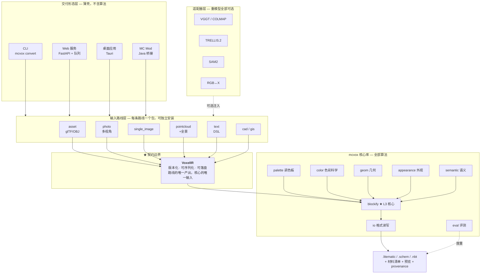
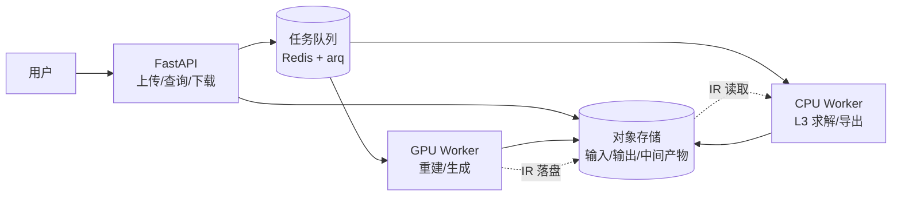

# 技术设计总纲

> AI 自动生成 Minecraft 体素对象
> 版本 v0.1 · 2026-08
> 前置：[PRD](00-PRD.md) · [可行性分析](01-feasibility.md) · [解决方案汇总](02-solutions.md)
> 细化：[公共库设计](05-core-library.md)

---

## 1. 设计出发点

三条约束共同决定了架构，且它们互相牵制：

1. **八条输入路线，一个后端。** 差异必须被隔离在最外层，核心层不能因为新增输入而改动。
2. **四种交付形态，一个核心库。** CLI、Web 服务、桌面应用、MC Mod 全部构建在同一个 Python 包上。
3. **重模型是可选依赖。** VGGT、TRELLIS、SAM2、RGB↔X 单个几个 GB，不能成为安装 mcvox 的硬门槛——否则"开发者在其上构建路线"这个 P0 场景不成立。

**这三条一起指向同一个结论：需要一个契约清晰、依赖可选、可分层复用的核心库。** 架构的其余部分都是这个结论的展开。

---

## 2. 总体架构



### 三条不可违反的架构规则

| 规则 | 内容 | 违反的后果 |
|---|---|---|
| **AR-1** | 路线层**只能**产出 `VoxelIR`，不得直接调用 `blockify` 内部 | 每条新路线都会侵蚀核心层，最终变成八套并行代码 |
| **AR-2** | 核心库**不得**直接 import 任何重模型包，只能通过适配器协议 | 安装 mcvox 会拖进几十 GB 依赖，第三方无法轻量集成 |
| **AR-3** | 交付形态层**不含**任何算法，只做参数编排、任务调度、结果呈现 | 四种形态间出现行为不一致，bug 需修四遍 |

> AR-1 是整个架构里最容易在赶工期时被违反的一条。**建议用 CI 依赖检查强制执行**（见[工程约定](09-conventions.md)），而不是靠代码评审的自觉。

---

## 3. 关键技术决策

以 ADR（架构决策记录）形式登记。每条决策记录**被否决的替代方案**，避免后来者重新提起。

### ADR-01 · 中间表示 VoxelIR 作为唯一契约

**决策**：所有输入路线产出 `VoxelIR`，核心层只消费 `VoxelIR`。IR 可序列化落盘、有 schema 版本号。

**理由**：
- 让 L3 团队能用固定的 IR 样本独立开发，不必等任何路线就绪 —— **这是并行开工的前提**
- 新增输入模态的成本降到"写一个产出 IR 的适配器"
- IR 落盘后可作为回归测试的固定输入，把 L1/L2 的随机性排除在 L3 测试之外

**被否决**：让每条路线直接调用 blockify 并各自传参。否决理由：三个月后核心层会长出八个分支。

### ADR-02 · 逐面存储外观，而非逐体素

**决策**：`albedo` 形状为 `(Nv, 6, 3)`。

**理由**：MC 方块各向异性（草方块顶绿侧土）；不同面被不同视角观测、置信度不同。逐体素平均会同时丢掉这两项信息。

**代价**：内存 ×6。实测 N=256 约 390 K 表面体素 × 6 面 × 3 通道 × 4 字节 ≈ 28 MB，可接受。

### ADR-03 · 显式保留亚体素残差

**决策**：IR 中保留 `residual`（真实表面到体素中心的有符号偏移）。

**理由**：标准体素化会丢弃这个量，但它正是楼梯/台阶拟合的驱动信号。**一旦在体素化阶段丢掉就再也拿不回来**。

### ADR-04 · 物理约束做后处理，不进能量函数

**决策**：`Φ_physics`、`Ψ_budget` 作为修复 pass 链执行，不作为 MRF 能量项。

**理由**：把硬约束塞进能量函数会破坏图割的可解性条件（Kolmogorov & Zabih 2004），而后处理 pass 效果等价、实现简单一个数量级，且每个 pass 可独立测试。

**代价**：修复可能轻微劣化颜色/材质匹配。可接受——物理合法性是硬门禁，颜色是软指标。

### ADR-05 · 只在表面体素上做 MRF

**决策**：内部体素直接填最便宜的结构方块，MRF 只在暴露体素上求解。

**理由**：规模降一个数量级（N=256 时从 ~10⁷ 降到 ~4×10⁵）；内部方块本就不可见，优化它是纯浪费。

### ADR-06 · 3D 蓝噪声抖动，不用 Floyd–Steinberg

**决策**：void-and-cluster 生成 3D 蓝噪声阈值场做有序抖动。

**理由**：FS 误差扩散产生方向性伪影，2D 固定视角下不显眼，3D 自由旋转下会突然刺眼。蓝噪声各向同性、可平铺、O(1) 查表、天然可复现（对 G5 可复现性目标很重要）。

**被否决**：表面参数化上做误差扩散——质量更高但实现复杂度高一档，列入 v2。

### ADR-07 · 重模型通过适配器协议注入，全部为可选依赖

**决策**：核心库定义 `Protocol`，重模型实现放在 `mcvox-adapters-*` 独立包，通过 entry_points 注册，缺失时优雅降级并给出明确提示。

**理由**：支撑 AR-2。让 `pip install mcvox` 保持在几十 MB 量级。

### ADR-08 · 实现语言 Python，Mod 形态用进程桥接

**决策**：核心库 Python 3.11+。MC Mod（D3）不重写算法，而是 Java 侧通过本地进程/HTTP 调用 Python 核心。

**理由**：整个 3D/CV 生态在 Python。用 Java 重写 L3 会产生两套需要同步的实现——这是最糟糕的一类技术债。

### ADR-09 · 内容哈希缓存

**决策**：每个 stage 输出按 `hash(输入 + 配置 + 代码版本)` 缓存。

**理由**：重建/生成阶段耗时以分钟计，调参时只改 L3 参数却要重跑全流程是不可接受的开发体验。**这直接影响迭代速度，是效率杠杆最大的基础设施之一。**

### ADR-10 · 一元项 GPU，成对项 CPU 分块

**决策**：一元代价矩阵在 GPU 上批量计算；α-expansion 在 CPU 多进程按 32³ 分块求解，块间重叠 4 体素做边界一致化。

**理由**：一元项是 `|V|×|B|` 的密集查表（GPU 强项）；图割是不规则图遍历（GPU 弱项，且成熟实现都在 CPU）。

---

## 4. 契约定义

### 4.1 VoxelIR schema（核心契约）

完整字段定义见[公共库设计 §3](05-core-library.md)。此处规定**契约性质**：

| 性质 | 规定 |
|---|---|
| 版本号 | `ir_version: str`，语义化。核心库拒绝加载不兼容的 major 版本 |
| 序列化 | `.npz`（数组）+ `.json`（元数据），或单一 `.mcir` 容器（zip） |
| 必填字段 | `occupancy`、`voxels_per_meter`、`ir_version`、`provenance` |
| 可选字段 | 其余全部。核心层对缺失字段必须有明确降级行为，不得崩溃 |
| 坐标约定 | 右手系，**Y 轴向上**（与 MC 一致），整数体素坐标，原点在包围盒最小角 |
| 颜色空间 | **OKLab**（IR 内统一），非 sRGB。避免各路线各自为政 |

> **降级行为必须明确定义并测试**：例如缺 `mat_logits` 时退化为纯颜色匹配，缺 `residual` 时禁用亚体素拟合。"缺字段就崩"是最常见的集成故障源。

### 4.2 Stage 协议

所有处理单元统一为 `(IR, Config) → IR` 的纯函数形式：

```python
class Stage(Protocol):
    name: str
    version: str
    def requires(self) -> set[str]: ...      # 需要 IR 的哪些字段
    def provides(self) -> set[str]: ...      # 产出/填充哪些字段
    def run(self, ir: VoxelIR, cfg: Config) -> VoxelIR: ...
```

`requires`/`provides` 让管线可以**静态校验**：编排时就能发现"你把亚体素拟合放在了残差计算之前"，而不是跑到一半才报错。

### 4.3 适配器协议

```python
class ReconstructionAdapter(Protocol):
    """VGGT / COLMAP / DUSt3R 等"""
    def reconstruct(self, images: list[Path], cfg: Config) -> ReconResult: ...

class SegmentationAdapter(Protocol):
    """SAM2 / Grounded-SAM 等"""
    def segment(self, image: NDArray, prompts: list[str] | None) -> list[Mask]: ...

class DelightAdapter(Protocol):
    """RGB↔X / IID 等"""
    def decompose(self, image: NDArray) -> IntrinsicChannels: ...

class Generative3DAdapter(Protocol):
    """TRELLIS.2 / Hunyuan3D 等"""
    def generate(self, cond: TextOrImage, cfg: Config) -> Generated3D: ...
    def native_sparse_voxels(self) -> SparseVoxelGrid | None:
        """★ 若模型内部就是稀疏体素（TRELLIS 系），直接暴露，
        让单图路线跳过 mesh↔voxel 往返。返回 None 表示不支持。"""
```

> 最后那个方法是 ADR 之外的一个关键设计点：它把[解决方案 §4.C2 的捷径](02-solutions.md)变成了协议的一等公民，而不是某条路线里的特例 hack。

---

## 5. 非功能设计

### 5.1 性能

预算见 [PRD §6.1](00-PRD.md#61-性能预算)。实现要点：

| 环节 | 策略 |
|---|---|
| 一元代价 | GPU 批量，`(Nv, B)` 分块避免显存爆炸 |
| MRF 求解 | CPU 多进程，32³ 分块，重叠 4 体素 |
| 体素化 | 快速缠绕数（BVH 加速），空间分块并行 |
| 投影烘焙 | 每相机一次 z-buffer 渲染，体素面批量查询 |
| 缓存 | 内容哈希（ADR-09），stage 级粒度 |
| 显存 | 重模型串行加载，用完显式释放；`max_vram` 配置项 |

### 5.2 可复现性（G5，硬门禁）

- 所有随机性由显式 `seed` 驱动，无隐式全局随机
- 蓝噪声阈值场预计算并随版本固定，不在运行时生成
- 浮点：MRF 求解前把代价量化为 int32，**消除浮点非确定性对离散结果的影响**
- `provenance` 记录全部版本与参数哈希
- CI 中有专门的"跑两遍结果必须逐字节相同"测试

> 第三条是容易被忽略的：图割求解器对代价的微小浮点差异可能产生完全不同的标注。量化为整数是让"相同输入→相同输出"真正成立的关键一步。

### 5.3 错误处理

| 类别 | 策略 |
|---|---|
| 输入不合法（破损网格、空点云） | 提前校验，给出**指向具体问题**的错误（"网格有 137 个非流形边"），而非通用异常 |
| 可选依赖缺失 | 明确提示缺哪个包、装什么、或如何降级运行 |
| 重建失败（SfM 不收敛） | 自动回退到兜底方案（VGGT → COLMAP），并在 provenance 中记录发生过回退 |
| 显存不足 | 自动降低分辨率或分块，警告而非崩溃 |
| 结果质量不达标 | 不静默通过。输出质量报告并标注可疑区域 |

### 5.4 可观测性

每次运行产出结构化 `run_report.json`：各 stage 耗时、峰值显存、中间指标、降级/回退记录、警告列表。这既是调试依据，也是商业服务的售后依据，还是回归测试的数据来源。

---

## 6. 交付形态设计

### 6.1 D0 · 核心库 + CLI（P0）

```bash
mcvox palette build --mc-version 1.21 --jar ~/.minecraft/versions/1.21/1.21.jar
mcvox palette gamut --out reports/E1.html          # ★ E1 实验
mcvox convert model.glb --out house.litematic --voxels-per-meter 4 --style medieval
mcvox convert --ir scene.mcir --out scene.schem    # 从落盘的 IR 直接跑 L3
mcvox eval run --suite objaverse-200
mcvox preview house.litematic --angles 4
```

设计要点：**`--ir` 入口让 L3 可以脱离任何路线独立运行**，这是 ADR-01 在 CLI 层面的体现，也是回归测试的基础。

### 6.2 D1 · Web 服务（P1）



- **GPU worker 与 CPU worker 分离**：L1/L2 吃显存，L3 吃 CPU 核。分开调度让 GPU 不被图割求解占着空转，显著降低单位成本
- IR 落对象存储作为两类 worker 的交接点 —— 又一次由 ADR-01 契约带来的红利
- 长任务：任务 ID + 轮询/SSE 进度，不用长连接
- **⚠️ 上线前必须解决 [PRD §7.2 版权架构冲突](00-PRD.md#72--版权架构冲突必须在-d1-形态设计前解决)**

### 6.3 D2 · 桌面应用（P1）

Tauri（Rust 壳 + Web 前端）+ 打包的 Python 运行时。

- **版权合规性最佳**：纹理提取全在本机，不触碰 §7.2 的冲突
- 主要成本在分发：CUDA/PyTorch 的跨平台打包体积大、依赖复杂
- 建议先支持"检测本机已有 Python 环境"模式，降低首版分发难度

### 6.4 D3 · MC Mod（P2）

Java 侧 Fabric/Forge mod，通过本地 HTTP 调用 Python 核心（ADR-08）。

- 生成耗时决定交互必须异步：游戏内下单 → 后台生成 → 完成后以 Litematica 投影形式呈现
- 不重写算法。Java 侧只做：参数 UI、进度显示、结果投影、放置辅助

---

## 7. 数据资产

见[解决方案 §9](02-solutions.md)。此处补充**治理规定**：

| 资产 | 存储 | 版本化 | 许可 |
|---|---|---|---|
| 调色板统计表 | `data/palette/<mcver>_<pack>.parquet` | 随 MC 版本 | **派生数值，仓库可提交；纹理绝不提交** |
| 材质映射表 | `data/mappings/<style>.yaml` | 语义化版本 | 基础版开源，精修版商业 |
| 方块属性表 | `data/blocks/<mcver>.yaml` | 随 MC 版本 | 开源 |
| 方块共现统计 | `data/priors/cooccur_<corpus>.npz` | 随语料 | **取决于语料许可，需逐个核实** |
| 亚体素模板库 | `data/subvoxel/templates.json` | 语义化版本 | 开源 |
| 回归测试集 | `tests/fixtures/` + 外部存储 | 随版本 | 取决于来源资产许可 |

**红线：仓库中不出现任何游戏纹理像素。** 建议加 CI 检查扫描图片文件，防止误提交。

---

## 8. 待决技术问题

| # | 问题 | 需在何时定 |
|---|---|---|
| T1 | IR 序列化用自定义 `.mcir` 还是标准格式（zarr/npz） | Phase 0 |
| T2 | 材质分类是微调专用模型还是纯开放词表零样本 | Phase 2 |
| T3 | 亚体素模板库的枚举范围（是否含 trapdoor/fence/wall） | Phase 2 |
| T4 | MRF 分块的重叠一致化策略（投票 / 二次求解 / 固定边界） | Phase 2 |
| T5 | 缓存后端（本地文件 / SQLite / 对象存储）在 D1 形态下的选择 | Phase 3 |
| T6 | 生物群系着色（草/叶/水）如何参数化 | Phase 1 |
