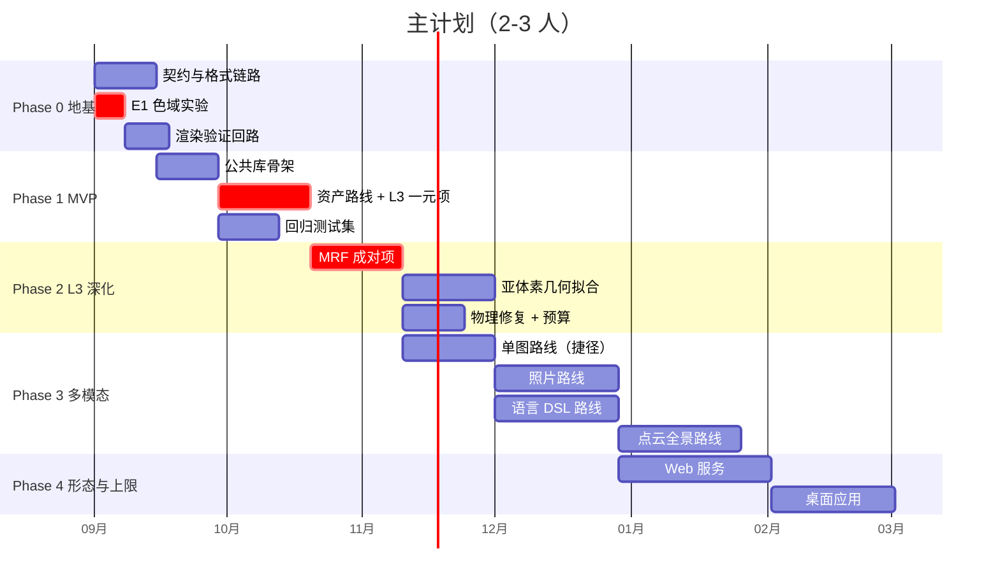
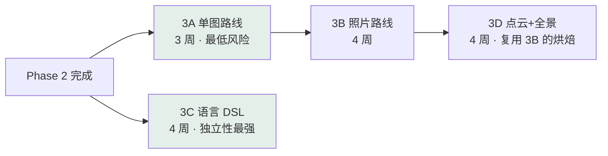

# 项目开展计划

> AI 自动生成 Minecraft 体素对象
> 版本 v0.1 · 2026-08
> 前置：[PRD](00-PRD.md) · [技术设计](04-tech-design.md) · [公共库设计](05-core-library.md)
> 配套：[分路线研发计划](07-route-plans.md) · [交付检查清单](08-CHECKLIST.md)

> **团队规模按 2–3 人编写主计划**（可行性分析中的估算基准）。1 人版与 6 人版的裁剪方案见 §6。

---

## 1. 总体节奏



| Phase | 周期 | 出口状态 |
|---|---|---|
| **0 · 地基** | 2–3 周 | 能手工造体素 → 导出 → **在真实游戏里放置成功**；E1 报告出炉 |
| **1 · MVP** | 4–6 周 | glTF/OBJ → 可用的 MC 结构；回归测试跑分基线建立 |
| **2 · L3 深化** | 4–6 周 | 质量达到"像人建的"；物理合法率 100% |
| **3 · 多模态** | 各 3–5 周，部分可并行 | 四条主输入路线可用 |
| **4 · 形态与上限** | 8–12 周 | Web 服务上线；桌面应用可分发 |

---

## 2. Phase 0 — 地基（2–3 周）

**这个阶段不写任何模型代码。** 目的是把三条"不通就一切归零"的链路先打通。

| 任务 | 产出 | 负责 |
|---|---|---|
| T0-1 | `VoxelIR` 契约定义 + `.mcir` 序列化 | 核心 |
| T0-2 | 调色板提取：`.jar` → `(方块,面) → Lab/方差/频率` | 核心 |
| T0-3 | **E1 色域分析报告** | 核心 |
| T0-4 | 导出链路：稀疏体素 → `.litematic` / `.schem` / `.nbt` | 工程 |
| T0-5 | **游戏内放置验证**（人工，录屏存档） | 工程 |
| T0-6 | 渲染验证回路（Chunky 或内置轻量渲染器） | 工程 |
| T0-7 | 仓库骨架：CI、依赖方向检查、纹理误提交扫描 | 工程 |
| T0-8 | PyPI 包名核实（Q4） | 任意 |

### Phase 0 门禁（全部通过才进入 Phase 1）

- [ ] 手工构造的体素数组导出后，在**真实 MC 客户端**加载并放置成功
- [ ] 三种格式往返读写逐方块一致
- [ ] E1 报告产出，且**已据此调整 PRD 中的质量承诺**
- [ ] CI 能拦截反向依赖与纹理文件提交
- [ ] `mcvox` 或替代包名已确认可用

> **T0-3 与 T0-5 是本阶段的两个真正关键项。** 其余任务失败只是延期，这两项失败意味着产品定义或技术路线要改。

---

## 3. Phase 1 — MVP：资产路线（4–6 周）

选择资产路线（D1）而非照片路线的理由见 [PRD](00-PRD.md) 与可行性分析：几何、外观、语义三项全已知，L1/L2 噪声为零，**让 L3 在干净条件下独立调优**。

| 任务 | 依赖 | 产出 |
|---|---|---|
| T1-1 | T0-1 | 公共库骨架：`core` / `color` / `config` / `cache` |
| T1-2 | T0-2 | `palette.registry` 落地，多版本缓存 |
| T1-3 | T1-1 | `geom.voxelize_solid`（广义缠绕数）+ `residual` |
| T1-4 | T1-2, T1-3 | `blockify.unary` 一元代价（GPU） |
| T1-5 | T1-4 | `color.dither` 3D 蓝噪声 + 贪心求解 |
| T1-6 | T1-2 | 材质映射表 v1（≥20 类）+ `blockify.mapping` |
| T1-7 | T1-3 | 资产路线 `asset_to_ir` |
| T1-8 | T0-6 | `eval` 指标 + Objaverse 200 回归集 |
| T1-9 | T1-5 | CLI `mcvox convert` 打通 |

### Phase 1 门禁

- [ ] `mcvox convert model.glb --out house.litematic` 单命令走通
- [ ] Voxel IoU ≥ 0.90（对水密真值）
- [ ] 回归测试集跑分基线入库，**后续每次提交自动对比**
- [ ] 抖动无方向性伪影（旋转 360° 目视验证 + 录屏）
- [ ] 可复现性测试通过（跑两遍逐字节相同）

---

## 4. Phase 2 — L3 深化（4–6 周）

这是**全项目投入最集中的阶段**（L3 占总工作量 55%）。

| 任务 | 依赖 | 产出 |
|---|---|---|
| T2-1 | T1-5 | `blockify.pairwise` 成对项 + 共现统计 |
| T2-2 | T2-1 | α-expansion 求解器 + 分块并行 |
| T2-3 | T1-3 | **`blockify.subvoxel`** 亚体素拟合 + 形状模板库 |
| T2-4 | T2-3 | `blockify.repair` 物理修复 pass 链 |
| T2-5 | T2-4 | `blockify.budget` 材料预算 |
| T2-6 | T1-6 | 多风格映射表（≥4 套） |
| T2-7 | T2-2 | 性能优化至 PRD §6.1 预算内 |

### Phase 2 门禁

- [ ] 物理合法率 **100%**（硬性）
- [ ] 亚体素拟合使屋顶/球面 Hausdorff 误差下降 ≥30%
- [ ] N=256 端到端 < 3 min
- [ ] 方块碎片化显著下降（连通块平均尺寸对比 Phase 1）
- [ ] 四套风格产出目视差异明显

> **T2-3 亚体素拟合是差异化程度最高的一项。** 若排期紧张，宁可推迟 T2-5 T2-6，也不要砍 T2-3——它是与通用体素工具拉开差距的地方。

---

## 5. Phase 3 & 4

Phase 3 的四条路线各自的详细计划见 **[分路线研发计划](07-route-plans.md)**。此处只给并行关系：



**并行建议**：3A 与 3C 无共享依赖，可完全并行（一人一条）。3D 依赖 3B 的投影烘焙实现，应串在其后。

Phase 4 形态层：

| 任务 | 前置条件 |
|---|---|
| Web 服务（D1） | **[PRD §7.2 版权方案法务意见](00-PRD.md#72--版权架构冲突必须在-d1-形态设计前解决)——阻塞项** |
| 桌面应用（D2） | D0 API 稳定至 v1.0 |
| 生成先验（F-26） | 语料许可核实完成（Q3） |

---

## 6. 团队规模裁剪方案

主计划按 2–3 人。团队规模确定后（[Q5](00-PRD.md#9-风险与未决问题)）按下表调整。

### 6.1 一人版（严格串行，约 9–12 个月到 v1）

**砍掉**：多风格映射表（只留 1 套）、Web 服务与桌面应用、点云路线、CAD/GIS 路线。

**保留主线**：Phase 0 → 资产路线 MVP → L3 深化 → 单图路线 → 语言路线。

| 调整 | 说明 |
|---|---|
| 里程碑判据 | 从"达标"放宽为"跑通"。指标阈值作为观测项而非门禁，**唯三例外**：游戏内加载成功、物理合法率、可复现性 |
| 路线取舍 | 只做资产 + 单图两条。单图路线走 TRELLIS 捷径，投入最小、观感最好 |
| 评测 | 回归集缩到 50 个对象，人工评价改为自评录屏 |
| 交付形态 | 只做 D0（库 + CLI），开源发布即达成主要目标 |

> 一人版的最大风险是**在 L3 上陷得太深而迟迟没有可展示成果**。建议强制约束：Phase 1 结束（约第 3 个月）必须有一个能发到社区的可用产物，哪怕质量只有 60 分。

### 6.2 二至三人版（主计划，约 6 个月到 v1）

| 角色 | 职责 | 关键产出 |
|---|---|---|
| **A · L3 主力** | `palette` / `color` / `blockify` 全栈 | E1 报告、一元项、MRF、亚体素、修复 |
| **B · 路线与集成** | `geom` / `appearance` / `semantic` + 各输入路线 | 资产/单图/照片/语言路线 |
| **C · 工程（0.5–1 人）** | `io` / `eval` / `viz` / CLI / CI / 服务化 | 导出链路、回归框架、渲染验证、Web 服务 |

**交接点**：A 与 B 通过 `VoxelIR` 契约解耦——B 产出 IR 样本落盘，A 拿固定样本开发 L3，**双方不需要等对方**。这是 ADR-01 在团队协作上的直接兑现。

### 6.3 四至六人版（约 4 个月到 v1，可并行更多路线）

在 2–3 人版基础上拆分：

| 新增角色 | 职责 |
|---|---|
| **A2 · L3 第二线** | A 做"调色板 + 一元项 + 求解器"，A2 做"亚体素 + 修复 + 预算"。两者在 `blockify` 内部按模块切分，接口是 `result` 结构 |
| **B2 · 路线第二线** | 四条路线两两并行：B 做单图+照片，B2 做语言+点云 |
| **D · 领域知识（兼职）** | 材质映射表精修、风格设计、游戏内验证。**最好由资深 MC 建筑玩家担任**，这个角色的价值被普遍低估 |

**并行的边界**：Phase 0 与 Phase 1 前半段（公共库骨架 + 契约）**不可并行**——人再多也要等契约定下来。强行并行只会产生返工。真正的并行窗口从 Phase 2 开始。

---

## 7. 关键路径

```
VoxelIR 契约 → 调色板 → 一元项 → MRF 求解 → 亚体素拟合 → 各路线
     ↑                ↑
  最优先          E1 实验（可与契约并行）
```

**关键路径上的任何延期都会 1:1 传导到项目总工期。** 相对地，以下工作**不在关键路径上**，可灵活调度：评测框架（但会拖慢迭代）、多风格映射表、可视化、Web 服务、CAD/GIS 路线。

---

## 8. 阶段门禁总表

| 门禁 | 时点 | 硬性条件 |
|---|---|---|
| **G0** | Phase 0 出口 | 游戏内放置成功 · E1 报告 · CI 就绪 |
| **G1** | Phase 1 出口 | CLI 走通 · IoU ≥0.90 · 回归基线 · 可复现性 |
| **G2** | Phase 2 出口 | 物理合法率 100% · 性能达标 · 亚体素收益验证 |
| **G3** | 每条路线出口 | 见[分路线计划](07-route-plans.md)各自的验收 |
| **G4** | D1 上线前 | **版权法务意见已获得** · 服务 SLO 达标 |

逐项可勾选清单见 **[08 · 交付检查清单](08-CHECKLIST.md)**。

---

## 9. 定期节奏

| 节奏 | 内容 |
|---|---|
| 每次提交 | 单元 + 契约 + 黄金测试；回归集跑分对比 |
| 每周 | 真实数据集（30 个）跑分；性能基准对比；风险登记册复盘 |
| 每阶段 | 门禁检查；游戏内人工验证 + 录屏；文档同步更新 |
| 每月 | 上游依赖版本审视（3D 生成领域迭代极快，半年前的 SOTA 可能已被替代） |

> 最后一条不是形式主义。TRELLIS → TRELLIS.2 的间隔约一年，且 O-Voxel 带来的 PBR 材质输出会直接影响本项目的 L2 设计。**架构里的适配器层就是为了让这种替换成本可控**——但前提是有人定期去看。
